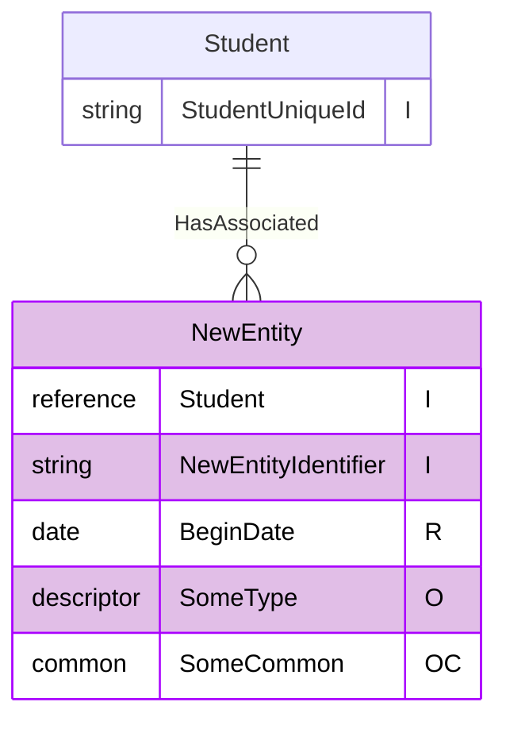

# Ed-Fi RFC Template

Copy everything below the line into `RFC/RFC-<NN><letter>_<Title-With-Hyphens>.md`.
Replace every `<placeholder>`. Delete any section marked _(if applicable)_ that
does not apply rather than leaving it empty. Delete the guidance comments.

---

# Ed-Fi RFC <NN><letter>: <Title> (<Domain>)

> **Product**: Ed-Fi Data Standard \
> **Affects**: Ed-Fi Data Standard v<X.Y>; Ed-Fi Resources API; <if there are new descriptors: Ed-Fi Descriptors API> \
> **Obsoletes**: -- <or link to the RFC this replaces> \
> **Obsoleted By**: -- \
> **Status**: Draft <Draft, Early Access, Active, Published, Obsolete> \
> **Author**: <Name, Organization> \
> **Date**: <Month D, YYYY>

## Synopsis

<!--
One or two paragraphs, written last. Cover: what the RFC introduces or changes;
the problem it solves; whether it is breaking; the target release; where to
comment (link). Must agree with the body word for word on decisions vs.
proposals.
-->

This Request for Comments (RFC) proposes <summary>. <One sentence on the problem.>

This is a <breaking | non-breaking> change targeted for Ed-Fi Data Standard
v<X.Y>.

## Background

<!--
The current model, precisely: entities, keys, elements involved. Then the
specific failure: what implementers cannot represent, must overwrite, or must
extend. Link tickets.
-->

### Current Model

### Problem

### Field Implementations and References

<!--
Name the states, vendors, extensions, and work groups that inform the design.
Note where surveyed implementers reported no use. List external standards and
alignment targets (CEDS, NCES, statute). Quantify impact where possible.
-->

- <Implementation or source, and what it contributes>

Related tickets: [<DATASTD-NNNN>](<link>), ...

## Use Cases

<!--
One subsection per use case. Name the actor, the action, and the outcome.
Each use case should map to entities in the Model section.
-->

### <Use Case Name>

<_Actor_ does _action_ so that _outcome_.>

## Proposal

<!--
Summary of the design choices, including the obvious alternative and why it
was not chosen. Say what happens to existing structures, and who should adopt
first.
-->

### Relationship to the Existing Model

### Alternatives Considered

### Differences from the Source Model _(if applicable)_

<!-- When promoting an extension or community model into core. -->

| Change | Reason |
| --- | --- |
| <change> | <reason> |

## Model

### Entity Relationship Overview



> **Notation:** `I` = identity (natural key), `R` = required, `O` = optional,
> `C` = collection (`RC`, `OC`). Highlighted entities are new or changed.
> Unchanged entities show only their keys.

<Cardinality statement, for example: one `Student` has zero or more `NewEntity` records.>

### <EntityName>

<Purpose paragraph. History semantics: does a change create a new record or update this one?>

**Identity**

| Field | Type | Description |
| --- | --- | --- |
| `<Field>` | <Reference \| String (n) \| Date \| Descriptor> | <Definition.> |

**Properties**

| Field | Type | Required | Description |
| --- | --- | --- | --- |
| `<Field>` | <Type with length or precision> | <Required \| Optional> | <Definition.> |

### New Descriptors _(if applicable)_

| Descriptor | Definition | Proposed Values or Source | Replaces |
| --- | --- | --- | --- |
| `<Name>` | <definition> | <values, or CEDS / state list> | -- |

### Authorization and Identity Considerations

<!--
How records are secured (education organization, namespace, person), and any
reference or key choices that affect authorization. Why each identity part is
in the key.
-->

## Breaking Changes and Migration _(if applicable)_

<!-- Delete for purely additive proposals; say "non-breaking" in the Synopsis instead. -->

### Identity Changes

| Entity | Current Key (v<X.Y>) | Proposed Key (v<X.Y>) |
| --- | --- | --- |
| `<Entity>` | <key> | <key> |

### Removed, Renamed, Relocated, and Deprecated Elements

| Element | Type | Change | Replacement and Reason |
| --- | --- | --- | --- |
| `<Entity.Element>` | <type> | <Deprecated \| Removed \| Renamed \| Relocated> | <replacement and reason> |

### Deprecation Timeline

<!-- Not always required; sometimes breaking changes have immediate affect. -->

- Introduce `<new element>` in Data Standard v<N>.
- Deprecate `<old element>` in Data Standard v<N> and v<N+1>.
- Remove `<old element>` in Data Standard v<N+2>.

### Migration Guidance

## API Specification

This RFC introduces <n> new resources in the `ed-fi` namespace. Each supports
`GET`, `POST`, `PUT`, and `DELETE`.

| Resource | Route |
| --- | --- |
| `<Resource>` | `/ed-fi/<resources>` |

API implementations and client systems are expected to follow the Ed-Fi API
Design and Implementation Guidelines; MUST requirements in that document apply.
Where this RFC differs from the Guidelines, this RFC takes precedence.

The OpenAPI specification is <linked here | published with Data Standard v<X.Y>>.

### Example

```json
{
  "studentReference": { "studentUniqueId": "604822" }
}
```

<Notes on what the API does and does not enforce in this example.>

## Review History

- <Month YYYY>: introduced at the Data Standard Work Group.
- <Month D, YYYY>: reviewed by <SIG>. Summary of feedback:
  - <point>

## Questions for the Community

<!--
Numbered and citable. Each gives context and the trade-off, then asks
something answerable. Mark in the body where each question applies.
-->

1. **RFC <NN><letter> Q1. <Short question title>.** <Context and trade-off.> <Question?>

If existing systems or business processes already address a concern above, no
change is needed; please say so.

### Out of Scope

- <Item and where it might be addressed instead>

## Timeline

- **Target release:** Ed-Fi Data Standard v<X.Y>.
- **Comment window:** <start date> to <end date>.

## How to Respond

When commenting, please include your organization type (SEA, LEA, vendor), state
or product, whether you use `<affected entities>` today, and your answers to the
questions above, cited by number.
