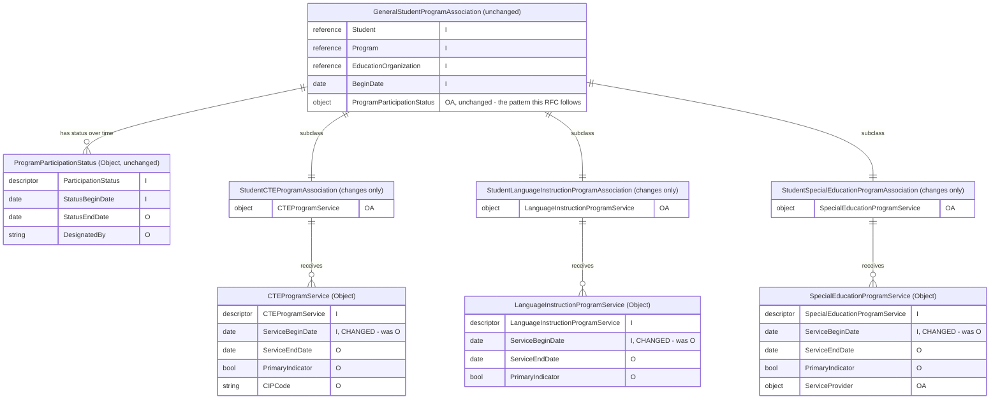

# Ed-Fi RFC 29d: Program Service Begin Date in Identity (Alternative and Supplemental Services Domain)

Product: Ed-Fi Data Standard \
Affects: Ed-Fi Data Standard v7.0 \
Obsoletes: -- \
Obsoleted By: -- \
Status: Draft for community feedback \
Author: Steven Arnold (Ed-Fi Alliance)

October 14, 2026

## Synopsis

This Request for Comments (RFC) includes materials that describe proposed revisions to the Ed-Fi Data Standard. This draft material is intended to support review and comment; users of this material are advised that this work is still under development.

RFC 29(d) adds `ServiceBeginDate` to the identity of the `CTEProgramService`, `LanguageInstructionProgramService`, and `SpecialEducationProgramService` objects, so that a service which stops and restarts within a school year is recorded as separate periods instead of one period overwriting another. It follows the pattern the model already uses for `ProgramParticipationStatus` on the same program associations.

This is a **breaking change** for the Alternative and Supplemental Services domain, targeted for Ed-Fi Data Standard v7.0. Other proposed changes to this domain are being published as separate RFCs.

---

## Glossary

- **Descriptor** — A reference to a value drawn from an extensible, namespaced code list. Unlike a fixed `Enumeration`, an implementation can add new Descriptor values without a change to the Data Standard itself.
- **Object** — A reusable, named group of fields embedded directly within an entity's own data. In the API, an Object appears as a nested JSON object; an **Object array** is a repeatable group of them. Unlike a `Reference`, an Object does not point to another resource — its fields belong to the entity itself.

---

## Overview

The Data Standard models a student's participation in a program through `GeneralStudentProgramAssociation` and its program-specific subclasses. Eight of those subclasses carry an Object array of the services the student received in the program — `StudentCTEProgramAssociation` carries `CTEProgramService`, `StudentLanguageInstructionProgramAssociation` carries `LanguageInstructionProgramService`, `StudentSpecialEducationProgramAssociation` carries `SpecialEducationProgramService`, and so on. In all eight service objects the service descriptor is the only identity field, and `ServiceBeginDate` and `ServiceEndDate` are optional.

That shape cannot represent a service that stops and restarts. Because the service descriptor alone identifies an entry, a student who receives the same service twice in a school year — for example, a language instruction service that ends in October and resumes in January — has only one entry available, and the second period either overwrites the first or is rejected as a duplicate. The begin and end dates are present on the object, but they describe only whichever period was written last.

The model already has a settled answer to this problem on the same association. `ProgramParticipationStatus`, an Object array carried on `GeneralStudentProgramAssociation` today, identifies each entry by a descriptor _and_ a begin date, so a status that changes during a participation keeps its history. This RFC applies that pattern to the program service objects: the service descriptor and `ServiceBeginDate` together identify a service period, and `ServiceEndDate` remains optional so that a service still in progress can be recorded.

Texas (TEA) extends the core model to key these three services on their begin dates, and is the primary field implementation informing this RFC. A second implementation has independently reported the same overwrite for language instruction services.

---

## Use Cases

### Services That Stop and Restart Within a School Year

Program services are not continuous. A student may exit a language instruction service and re-enter it later in the year, a special education service may be suspended and resumed, and a CTE service may end with one course and begin again with the next. Each of these is the same service descriptor with a different period, and the current model can hold only one of them. State reporting and funding calculations that depend on program services need to know when each service applied, so when a later period overwrites an earlier one, any count, duration, or funding figure built on the lost period is understated without any visible error. To avoid this, at least one implementation has been advised to create additional descriptor values for the same service so that each period has a unique key — encoding a date in a code list meant to name services, and making those values impossible to compare across implementations. Adding `ServiceBeginDate` to the identity makes each period its own entry, so every period submitted is retained and the service descriptor can return to naming only the service.

---

## Model

### Entity Relationship Overview

> **Notation:** `I` = identity / key · `R` = required · `O` = optional · `A` = array (`RA`/`OA`) · flags: `CHANGED`, and inline notes. Entities marked _changes only_ show the fields relevant to this RFC; all other fields are unchanged. `ProgramParticipationStatus` is drawn unchanged, as the existing precedent. All DS 6.1 field names, types, cardinalities and identity components in this document were verified against `@edfi/ed-fi-model-6.1`, MetaEd `projectVersion` 6.1.0.

Each program association relates to its service objects as **1 → 0..\***, and that cardinality is unchanged: a student may participate in a program and receive no service. What changes is that two entries for the same service are distinguished by their begin dates instead of colliding.

### CTEProgramService, LanguageInstructionProgramService, SpecialEducationProgramService

`ServiceBeginDate` moves from an optional property into the identity of these three objects, after the service descriptor, matching the order of `ProgramParticipationStatus` (descriptor, then `StatusBeginDate`). The existing documentation — "First date the student was in this option for the current school year" — is retained. It already scopes the date to a single school year, so keying it does not create identity across years.

`ServiceEndDate` deliberately stays optional and out of the identity. A service that is still in progress has no end date, and keying it would make an open service impossible to record.

A non-breaking alternative — leaving the identity unchanged and adding an array of service periods beneath each service — was considered and set aside. With the service descriptor still the only identity field, such an array records the periods during which the entry existed, not which service applied in which period, and so reproduces the problem one level down.

The other five program service objects — `TitleIPartAProgramService`, `HomelessProgramService`, `MigrantEducationProgramService`, `NeglectedOrDelinquentProgramService`, and `SchoolFoodServiceProgramService` — are structurally identical and are not changed by this RFC. Whether they should be is put to the community below.

**Identity** (all three objects)

| Field | Type | Description |
| --- | --- | --- |
| `CTEProgramService` / `LanguageInstructionProgramService` / `SpecialEducationProgramService` | Descriptor | The service received. Existing identity field, unchanged. |
| `ServiceBeginDate` | Date | First date the student was in this service for the current school year. Existing field, **promoted from optional to the identity**. |

**Properties**

| Field | Type | Required | Description |
| --- | --- | --- | --- |
| `ServiceEndDate` | Date | Optional | Existing field, unchanged. Deliberately not part of the identity. |
| `PrimaryIndicator` | Boolean | Optional | Existing field, unchanged. |
| `CIPCode` | String (120) | Optional | `CTEProgramService` only. Existing field, unchanged. |
| `ServiceProvider` | Object array | Optional | `SpecialEducationProgramService` only. Existing field, unchanged. |

---

## Breaking Changes & Migration

The proposed identity changes:

| Object | DS 6.1 key | Proposed DS 7.0 key |
| --- | --- | --- |
| `CTEProgramService` | `CTEProgramService` | `CTEProgramService` + `ServiceBeginDate` |
| `LanguageInstructionProgramService` | `LanguageInstructionProgramService` | `LanguageInstructionProgramService` + `ServiceBeginDate` |
| `SpecialEducationProgramService` | `SpecialEducationProgramService` | `SpecialEducationProgramService` + `ServiceBeginDate` |

Change by change:

- `ServiceBeginDate` on the three objects becomes **part of the identity, and therefore required**. A client that sends one of these services without a begin date will receive a validation error. Clients that send no services are unaffected, because the service arrays on the program associations remain optional.
- **Existing service records without a `ServiceBeginDate` cannot be migrated mechanically.** There is no defensible default: substituting the program association's `BeginDate` would assert a service start that was never reported. Implementations should expect to source the value or drop the record.
- Service periods that previously overwrote one another become distinct records after migration, so service record counts will rise, and any count-based reconciliation built on the old key will shift.
- Implementations that created distinct descriptor values to work around the current key can collapse them back to the underlying service descriptor once the begin date is part of the identity.
- No fields are added, removed, or renamed. `StudentCTEProgramAssociation`, `StudentLanguageInstructionProgramAssociation`, and `StudentSpecialEducationProgramAssociation` keep their own identities; only the identity of the service entries within them changes.

---

## Questions for the Community

1. **Should `ServiceBeginDate` be part of the identity, and on which program service objects?** This RFC proposes the change on three objects — CTE, Language Instruction, and Special Education — because those are where the overwrite has been reported. All eight program service objects share the same shape, however, and nothing in the cause of the problem is specific to the three: any program whose services can stop and restart within a year can overwrite one period with another. Because the change is breaking, extending it to the other five later would require a second breaking release. Should the change apply to the three proposed, to all eight, to a different subset — or is a breaking identity change the wrong remedy altogether?
2. **Are program services ever reported without a begin date?** The proposal assumes a service with no begin date does not occur in practice. If your implementation sends services without one, please say so, and for which programs, since those records would need a source for the date before migration.

---

## Timeline

- **Target release:** DS 7.0.
- **Community:** open for feedback now, ahead of finalization and review by the Data Standard Workgroup.

---

## How to Respond

Please comment with your implementation context — which program service objects you populate today, whether you have encountered services overwriting one another or have extended the model to avoid it, and whether `ServiceBeginDate` is always available in your source systems — along with your answers to the questions above. Your feedback will shape the final RFC submitted to the governance process.
