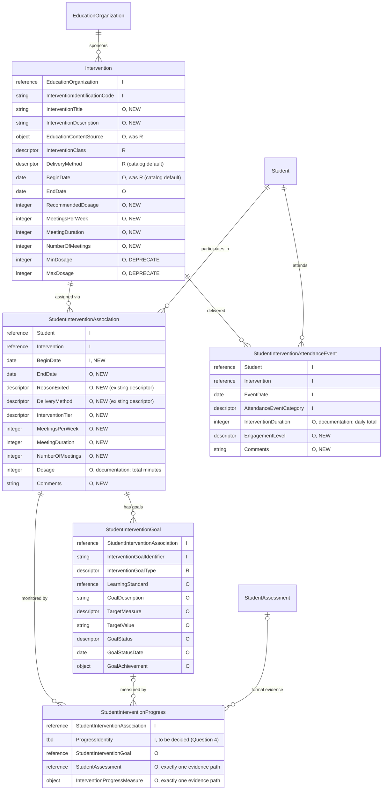

# Ed-Fi RFC 29e: Intervention Plans, Goals, and Progress Monitoring (Intervention Domain)

Product: Ed-Fi Data Standard \
Affects: Ed-Fi Data Standard v7.0 \
Obsoletes: -- \
Obsoleted By: -- \
Status: Draft for community feedback \
Author: Steven Arnold (Ed-Fi Alliance)

October 14, 2026

## Synopsis

This Request for Comments (RFC) includes materials that describe proposed revisions to the Ed-Fi Data Standard. This draft material is intended to support review and comment; users of this material are advised that this work is still under development.

RFC 29e makes `StudentInterventionAssociation` the record of a student's intervention plan, moving student-specific dates, delivery method, exit and schedule onto it and adding a multi-tiered system of supports (MTSS) tier. It introduces two new domain entities, `StudentInterventionGoal` and `StudentInterventionProgress`, so that the model can record what an intervention is meant to achieve for a student and the evidence of progress toward it. It also completes `Intervention` as a student-agnostic catalog entry and adds engagement and comments to each intervention attendance event.

This is a **breaking change** for the Intervention domain: `BeginDate` joins the identity of `StudentInterventionAssociation`. It is being published for community feedback before it is finalized, and the progress record is deliberately incomplete until the community answers the questions below.

---

## Glossary

- **Descriptor** — A reference to a value drawn from an extensible, namespaced code list. Unlike a fixed `Enumeration`, an implementation can add new Descriptor values without a change to the Data Standard itself.
- **MTSS (multi-tiered system of supports)** — A framework in which students receive increasingly intensive support in tiers, commonly Tier 1 (universal, whole-class), Tier 2 (targeted, small-group) and Tier 3 (intensive, individual). The same intervention can be delivered at more than one tier.
- **Object** — A reusable, named group of fields embedded directly within an entity's own data. In the API, an Object appears as a nested JSON object; an **Object array** is a repeatable group of them. Unlike a `Reference`, an Object does not point to another resource — its fields belong to the entity itself.
- **Reference** — An object containing the natural key (identity) values of another resource, used to link one entity to another without embedding that resource's own data. In the API, a Reference appears as a nested object holding only the identifying fields of the resource it points to.

---

## Overview

The Ed-Fi Data Standard models interventions with a catalog entity, `Intervention`, and a student link, `StudentInterventionAssociation`, supported by `StudentInterventionAttendanceEvent` for delivered sessions and `InterventionPrescription` for a general, research-based approach. `Intervention` is keyed on `EducationOrganization` + `InterventionIdentificationCode` and carries the domain's only begin date and delivery method, both required. `StudentInterventionAssociation` is keyed on `Student` + `Intervention` alone and carries a cohort, a diagnostic statement, a research-based effectiveness rating and a `Dosage` in minutes. The shape of these entities has not changed since Data Standard 4.0.

That structure puts the student's plan on the wrong entity. Implementers treat `Intervention` as a library entry that many students are assigned to, but each student's assignment has its own start and end, its own delivery method, its own tier and its own schedule, and none of these can be recorded on the association. Because the association's identity has no date, a student cannot be assigned to the same intervention twice in a year, which is common when a student exits and later re-enters support. There is no standard way to record that a student left an intervention or why. And the model can say whether an intervention was delivered — dosage and attendance — but not whether it worked: there is nowhere to record the goal an intervention targets for a student, and no link from the student's plan to the evidence that measures progress toward it. That evidence often already exists in Ed-Fi as `StudentAssessment` records whose source of truth is not the intervention provider, and just as often it is a short provider-recorded probe or mastery check that is not a formal assessment at all.

Michigan, implementing reporting for its high-impact tutoring program (Section 23G), extended the core model to fill these gaps: begin and end dates, an exit reason and meetings per week on `StudentInterventionAssociation`, an academic subject on `Intervention`, and a simplified student intervention assessment, built because the full Assessment domain was more than its tutoring providers could implement for a high-level score. It is the primary field implementation informing this RFC.

This RFC draws a clear line between the catalog and the plan. `Intervention` keeps what is true of the intervention in general — a title, a description, recommended schedule values and defaults — with its begin date relaxed to optional and its delivery method kept as a required default. `InterventionPrescription` is retained, so an implementation can either define a general approach and deploy it as an `Intervention`, or use `Intervention` directly as its catalog. `StudentInterventionAssociation` becomes the student's plan, keyed on its begin date, with the operative dates, tier, delivery method, schedule and exit. Goals and progress hang off the plan: `StudentInterventionGoal` records what the intervention should achieve for the student, and `StudentInterventionProgress` records each progress point, either as a reference to an existing `StudentAssessment` or as a lightweight measure recorded directly. Screening and identification of students for intervention, and fidelity of implementation, are not addressed by this RFC.

---

## Use Cases

### Student-Specific Intervention Plans

Every student assigned to an intervention has a plan that differs from the catalog and from other students' plans: the dates they started and stopped, whether they received it one-on-one or in a small group, the tier of support it represents for them, how often and how long they are scheduled to meet, and why they exited. Today the only begin date and delivery method sit on `Intervention`, where one value must serve every student, and the association has no exit, no tier and only a total-minutes `Dosage`, so providers either overload the catalog or keep the plan outside Ed-Fi. Tier cannot be inferred from delivery method, because a Tier 1 intervention can be delivered in a small group and a Tier 2 intervention individually. Adding `BeginDate` to the association's identity lets a student hold separate, dated assignments to the same intervention over time, and adding `EndDate`, `ReasonExited`, `DeliveryMethod`, `InterventionTier` and three schedule fields gives each plan its own operative values. Adding an engagement level and comments to the attendance event lets each delivered session record not only that the student was present but how the student took part.

### Goals and Progress Monitoring

Knowing whether an intervention worked requires knowing what it was meant to achieve and what the evidence shows. The model has neither: there is no goal on a student's intervention, and no link between the plan and the scores or checks that monitor progress, so effectiveness cannot be exchanged or reported through Ed-Fi. `StudentInterventionGoal` records one or more goals per plan, with a goal type, an optional learning standard, what is measured, the target value, a status and the period in which the goal should be met, deliberately without assessment terminology because a target is not always an assessment score. `StudentInterventionProgress` records each progress point on the plan and, optionally, the goal it measures. Its evidence is either a reference to a formal `StudentAssessment` already in Ed-Fi, which stays the source of truth and can be linked by any party permitted to read both records, or a lightweight measure recorded directly by the provider for probes and mastery checks that will never be formal assessments. One record type serves both, so a consumer reads progress in one place regardless of how it was measured.

### Completing the Intervention Catalog

The model already has a student-agnostic catalog of interventions. When student-specific values move to the plan, `Intervention` can fully serve as the catalog that implementers already use it as. Today it cannot even name itself, because it has an identification code but no title or description. It also requires a begin date and an education content source that a catalog entry may not have. Its minimum and maximum dosage express a range that implementers do not use, while providers describe their programs by a recommended total and a recommended schedule. This RFC:

- adds an optional title and description;
- relaxes the begin date and education content source to optional, keeping delivery method required as the catalog default;
- replaces the dosage range with `RecommendedDosage`, alongside recommended meetings per week, meeting length and number of meetings.

Together these give the catalog a vocabulary that mirrors the student plan field for field, so a plan can be read against the intervention's recommendation.

---

## Model

### Entity Relationship Overview

> **Notation:** `I` = identity / key · `R` = required · `O` = optional · `A` = array (`RA`/`OA`) · flags: `NEW`, `DEPRECATE`, and inline notes for changes. `StudentInterventionGoal` and `StudentInterventionProgress` are new entities; every field on them is new. Unchanged fields not relevant to this RFC are omitted from the diagram and listed in the tables below.

A student has **0..\*** plans per intervention, one per begin date. Each plan has **0..\*** goals and **0..\*** progress records, and a progress record may name one of the plan's goals.

### Design Principle: Catalog Defaults, Plan Values

A value that can differ between students belongs on `StudentInterventionAssociation`; `Intervention` holds only the general or recommended value. Where both carry a field — `DeliveryMethod`, and the schedule fields — the catalog value is a default or recommendation and the plan value is operative. The four schedule fields on each entity (`Dosage` or `RecommendedDosage` for total minutes, `MeetingsPerWeek`, `MeetingDuration`, `NumberOfMeetings`) are independent, optional ways to express a prescribed schedule. None is derived from another, and the model does not validate them against each other; delivered time continues to come from `StudentInterventionAttendanceEvent.InterventionDuration`.

### StudentInterventionAssociation

`StudentInterventionAssociation` becomes the student's intervention plan. `BeginDate` joins the identity, following the pattern of other participation associations in the model such as the program associations (through `GeneralStudentProgramAssociation`), `StudentSectionAssociation` and `StudentCohortAssociation`, so a student can hold more than one dated assignment to the same intervention. No other core entity references `StudentInterventionAssociation`, so the key change does not cascade within the model; the break is in the API. `Dosage` keeps its type, but its documentation is tightened to mean the **total** assigned minutes: Michigan documents it as minutes per session, and that meaning now belongs to `MeetingDuration`. Scheduled clock times (`MeetingTime`) are not added to the plan, because that object holds only start and end times without days or dates and does not describe how interventions are scheduled.

**Identity**

| Field | Type | Description |
| --- | --- | --- |
| `Student` | Reference | Existing field, unchanged. |
| `Intervention` | Reference | Existing field, unchanged. |
| `BeginDate` | Date | The date the student began participating in the intervention. New field, part of the identity. |

**Properties**

| Field | Type | Required | Description |
| --- | --- | --- | --- |
| `EndDate` | Date | Optional | The date the student exited or completed the intervention. New field. |
| `ReasonExited` | Descriptor | Optional | The reason the student exited the intervention. New field using the existing `ReasonExited` descriptor, whose documentation is broadened from programs to programs or interventions. |
| `DeliveryMethod` | Descriptor | Optional | The way in which the intervention is delivered to this student; overrides any default on `Intervention`. New field using the existing descriptor. |
| `InterventionTier` | Descriptor | Optional | The tier of support at which the intervention is provided to this student within an MTSS framework. New descriptor. |
| `MeetingsPerWeek` | Integer | Optional | The number of times per week the intervention is prescribed to meet for this student. New field. |
| `MeetingDuration` | Integer | Optional | The prescribed length of each meeting for this student, in minutes. New field using the existing `Duration` type (minimum 1). |
| `NumberOfMeetings` | Integer | Optional | The total number of meetings prescribed for this student. New field. |
| `Dosage` | Integer | Optional | The total duration of time, in minutes, that the student is assigned to participate in the intervention. Existing field; documentation clarified to mean total time. |
| `Comments` | String (1024) | Optional | Any comments about the student's participation in the intervention. New field. Distinct from `DiagnosticStatement`, which records why the student was assigned. |
| `Cohort` | Reference | Optional | Existing field, unchanged. |
| `InterventionEffectiveness` | Object array | Optional | Existing field, unchanged. This is a research-based effectiveness rating for the intervention, not a record of the student's progress. |
| `DiagnosticStatement` | String (1024) | Optional | Existing field, unchanged. |

### Intervention

`Intervention` becomes a student-agnostic catalog entry. It gains a title and description. Its begin date becomes optional now that the operative dates live on the plan. Its delivery method stays required: it is the catalog default, so every intervention states how it is delivered, and a student's plan can override it. `EducationContentSource` becomes optional because it is already optional in practice: the API accepts intervention records without it, since the object has no identity and every field in it is optional. Relaxing its cardinality makes the model match field reality rather than introducing a requirement implementations do not enforce. `RecommendedDosage` replaces the `MinDosage`/`MaxDosage` range, which is deprecated, and the three recommended schedule fields mirror the plan's. `InterventionTier` is not added to the catalog: the same intervention can be delivered at different tiers, and carrying tier in two places would need a precedence rule.

**Identity**

| Field | Type | Description |
| --- | --- | --- |
| `EducationOrganization` | Reference | Existing field, unchanged. |
| `InterventionIdentificationCode` | String (120) | Existing field, unchanged. |

**Properties**

| Field | Type | Required | Description |
| --- | --- | --- | --- |
| `InterventionTitle` | String (255) | Optional | The title or name of the intervention. New field. |
| `InterventionDescription` | String (1024) | Optional | A description of the intervention, its approach and its intended use. New field. |
| `EducationContentSource` | Object | Optional | Existing field; changed from required to optional so the model matches the API, which already accepts records without it. |
| `InterventionClass` | Descriptor | Required | Existing field, unchanged. |
| `DeliveryMethod` | Descriptor | Required | The default way in which the intervention is delivered; a student's plan may override it. Existing field; documentation clarified. |
| `BeginDate` | Date | Optional | The start date of the intervention's availability or implementation; a student's start date is recorded on `StudentInterventionAssociation`. Existing field; changed from required to optional. |
| `EndDate` | Date | Optional | Existing field, unchanged. |
| `RecommendedDosage` | Integer | Optional | The recommended total duration of time, in minutes, for the intervention. New field. |
| `MeetingsPerWeek` | Integer | Optional | The recommended number of times per week the intervention meets. New field. |
| `MeetingDuration` | Integer | Optional | The recommended length of each meeting, in minutes. New field. |
| `NumberOfMeetings` | Integer | Optional | The recommended total number of meetings. New field. |
| `MinDosage` | Integer | Optional | Existing field; deprecated in favor of `RecommendedDosage`. |
| `MaxDosage` | Integer | Optional | Existing field; deprecated in favor of `RecommendedDosage`. |
| `Diagnosis` | Descriptor array | Optional | Existing field, unchanged (see Questions for the Community). |
| `PopulationServed` | Descriptor array | Optional | Existing field, unchanged. |
| `AppropriateSex` | Descriptor array | Optional | Existing field, unchanged. |
| `AppropriateGradeLevel` | Descriptor array | Optional | Existing field, unchanged. |
| `InterventionPrescription` | Reference array | Optional | Existing field, unchanged. |
| `MeetingTime` | Object array | Optional | Existing field, unchanged. |
| `Staff` | Reference array | Optional | Existing field, unchanged. |
| `Namespace` | String (255) | Optional | Existing field, unchanged. |

### InterventionPrescription

`InterventionPrescription` is retained, together with `EducationOrganizationInterventionPrescriptionAssociation` and `InterventionStudy`. Two paths are therefore supported:

- An implementation can define a general, research-based approach as a prescription and deploy it as one or more `Intervention` records.
- It can skip the prescription and use `Intervention` directly as its catalog. This is how MTSS products model interventions today.

`EducationContentSource` changes from required to optional on `InterventionPrescription`, for the same reason as on `Intervention`: it is already optional in the API, and the model now matches field reality. Nothing else on the entity changes in this RFC; its `MinDosage` and `MaxDosage` are not deprecated here. Whether the prescription and `InterventionStudy` are in use, and whether the entity should be renamed, are Questions 9 and 18.

### StudentInterventionGoal

`StudentInterventionGoal` records a goal on a student's intervention plan. Its identity is the plan plus a provider-assigned identifier, following `StudentIEPGoal`, so a plan can hold several goals. The required `InterventionGoalType` classifies every goal, including behavior, attendance and social-emotional goals that have no academic standard. `LearningStandard` is optional, so that an academic goal can name the competency it targets using the model's single abstraction for competencies, without requiring one where none applies. `TargetMeasure` and `TargetValue` describe the target in the goal's own terms rather than in assessment terminology, because a goal's target is not always an assessment score. `GoalStatus` is a descriptor rather than a completed indicator so that it can express "not met" and "discontinued" as well as "met". The existing `Goal` entity is not reused because it belongs to the educator preparation domain and is tied to a person, not to a student's intervention.

**Identity**

| Field | Type | Description |
| --- | --- | --- |
| `StudentInterventionAssociation` | Reference | The student's intervention plan to which the goal belongs. |
| `InterventionGoalIdentifier` | String (120) | A unique identifier for the goal, assigned by the provider of the intervention. |

**Properties**

| Field | Type | Required | Description |
| --- | --- | --- | --- |
| `InterventionGoalType` | Descriptor | Required | The type of goal, for example Academic, Behavioral, Attendance or Social-emotional. New descriptor. |
| `LearningStandard` | Reference | Optional | The learning standard or competency the goal targets, where one applies. |
| `GoalDescription` | String (1024) | Optional | A description of the goal. |
| `TargetMeasure` | Descriptor | Optional | What is measured to judge progress toward the goal, for example words correct per minute or office referrals per week. New descriptor. |
| `TargetValue` | String (60) | Optional | The value of the target measure the student is expected to reach. New shared type. |
| `GoalStatus` | Descriptor | Optional | The status of the goal, for example In progress, Met, Not met or Discontinued. New descriptor. |
| `GoalStatusDate` | Date | Optional | The date the goal status was last determined. |
| `GoalAchievement` | Object | Optional | The period in which the goal is to be achieved, using the existing `Period` object (`BeginDate` required, `EndDate` optional). |

### StudentInterventionProgress

`StudentInterventionProgress` records one progress point on a student's intervention plan and, optionally, the goal it measures. Each record carries its evidence in exactly one of two ways. A **formal** progress point references a `StudentAssessment` already recorded in Ed-Fi; the assessment record stays the source of truth, and the progress record only connects it to the plan, so it can be posted by any party permitted to read both, such as a district warehouse, rather than by the intervention provider. A **lightweight** progress point carries an `InterventionProgressMeasure` object recorded directly, for provider-written probes and program mastery checks that will never be formal assessments; this follows the simplified assessment Michigan built for the same reason. The two evidence fields are both optional, with documentation stating that exactly one is sent; enforcement belongs to implementation validation rules rather than the model. The entity is a domain entity because it references an association. The referenced `StudentAssessment` must belong to the same student as the plan, and a referenced goal must belong to the same plan.

The record's second identity element, the contents of `InterventionProgressMeasure`, and whether a lightweight point must name a goal are open (Questions 3–5). The entity cannot be finalized until they are answered. The existing `Path` entity, used for progress against a graduation plan, is being reviewed as a possible basis for the progress record.

**Identity**

| Field | Type | Description |
| --- | --- | --- |
| `StudentInterventionAssociation` | Reference | The student's intervention plan whose progress this record measures. |
| _To be decided_ | — | A second identity element; see Question 4. `StudentAssessment` cannot serve, because it is optional. |

**Properties**

| Field | Type | Required | Description |
| --- | --- | --- | --- |
| `StudentInterventionGoal` | Reference | Optional | The goal on the plan that this progress point measures, if any. Whether this is required for lightweight points is Question 4. |
| `StudentAssessment` | Reference | Optional | A formal assessment result, already recorded in Ed-Fi, used as progress evidence. Send exactly one of this or `InterventionProgressMeasure`. |
| `InterventionProgressMeasure` | Object | Optional | A progress point recorded directly, for measures that are not formal assessments. Send exactly one of this or `StudentAssessment`. New object type; contents are Question 3. |

### StudentInterventionAttendanceEvent

`StudentInterventionAttendanceEvent` gains an optional engagement level and comments. Engagement is a spectrum — a student can be present but disengaged — so it is a descriptor rather than a flag, and it is recorded per session, on the event, rather than on the plan. Both fields are added to the entity rather than to the shared `AttendanceEvent` object, which school, section and program attendance events also use. The event's identity is unchanged, so it still allows one event per student, intervention, date and category; `InterventionDuration` documentation is clarified to mean the daily total where a student has more than one session on a date (see Question 8). No reference to `StudentInterventionAssociation` is added: an event belongs to the plan whose `BeginDate`–`EndDate` range contains its `EventDate`, and best-practice guidance will recommend that one student's plans for the same intervention do not overlap in time.

**Identity**

| Field | Type | Description |
| --- | --- | --- |
| `Student` | Reference | Existing field, unchanged. |
| `Intervention` | Reference | Existing field, unchanged. |
| `EventDate` | Date | Existing field (from the `AttendanceEvent` object), unchanged. |
| `AttendanceEventCategory` | Descriptor | Existing field (from the `AttendanceEvent` object), unchanged. |

**Properties**

| Field | Type | Required | Description |
| --- | --- | --- | --- |
| `EngagementLevel` | Descriptor | Optional | The degree to which the student engaged in the intervention session. New descriptor. |
| `Comments` | String (1024) | Optional | Any comments about the student's participation in the session. New field. The reason for an absence continues to be recorded in `AttendanceEventReason`. |
| `InterventionDuration` | Integer | Optional | The duration in minutes of the intervention attendance event; where a student attends more than one session of the same intervention on one date, the total for the date. Existing field; documentation clarified. |
| `AttendanceEventReason` | String | Optional | Existing field, unchanged. |
| `EducationalEnvironment` | Descriptor | Optional | Existing field, unchanged. |
| `EventDuration` | Decimal | Optional | Existing field, unchanged. |

### New Object Type: InterventionProgressMeasure

A progress point on a student's intervention, recorded directly rather than as a formal assessment result. Its contents are Question 3.

### New Descriptors

| Descriptor | Notes |
| --- | --- |
| `InterventionTier` | The tier of support within an MTSS framework at which an intervention is provided, for example Tier 1, Tier 2, Tier 3. |
| `InterventionGoalType` | The type of goal for a student's intervention. Kept separate from `IEPGoalType` and from the educator `GoalType`, whose values serve other domains. |
| `TargetMeasure` | The measure used to judge progress toward a goal. |
| `GoalStatus` | The status of progress toward a goal. |
| `EngagementLevel` | The degree to which a student engaged in an activity, for example Fully engaged, Partially engaged, Present but disengaged. |

### Naming Conventions

The schedule fields use **Meeting** rather than "Session", because `Session` is the Ed-Fi entity for an academic term and already appears at the front of property names with that meaning; "Meeting" matches the domain's existing `MeetingTime`. `MeetingsPerWeek` follows the model's "…PerWeek" naming (`HoursPerWeek`), and `NumberOfMeetings` follows its `NumberOf…` family. The catalog's single dosage value takes the role name `Recommended`, matching the catalog's recommended schedule fields. `InterventionTier` is named for the domain rather than for a particular framework, so that it is not tied to one state's or product's terminology.

---

## Breaking Changes & Migration

The proposed identity change is summarized below:

| Entity | DS 6.1 key | Proposed DS 7.0 key |
| --- | --- | --- |
| `StudentInterventionAssociation` | `Student` + `Intervention` | `Student` + `Intervention` + `BeginDate` |
| `StudentInterventionGoal` (new) | — | `StudentInterventionAssociation` + `InterventionGoalIdentifier` |
| `StudentInterventionProgress` (new) | — | `StudentInterventionAssociation` + _to be decided (Question 4)_ |

- `BeginDate` added to the `StudentInterventionAssociation` identity. Existing records must be re-keyed with a begin date: use the date the student was assigned to the intervention in the source system, falling back to `Intervention.BeginDate` where the source system has no student-specific date.
- `StudentInterventionGoal` and `StudentInterventionProgress` reference the new `StudentInterventionAssociation` key and cannot be adopted without it.
- `Intervention.BeginDate` changes from required to optional; consumers must tolerate its absence. `Intervention.DeliveryMethod` stays required.
- `EducationContentSource` changes from required to optional on `Intervention` and `InterventionPrescription`. The API already accepts records without it, so this aligns the model with existing behavior rather than changing it.
- `StudentInterventionAssociation.Dosage` is clarified to mean total assigned minutes. The schema does not change, but implementers who send minutes per session in `Dosage` should move that value to `MeetingDuration`.
- `Intervention.MinDosage` and `Intervention.MaxDosage` are flagged as deprecated in DS 7.0 in favor of `RecommendedDosage`, and will be removed in a future release. Implementers can keep sending them during the deprecation period.
- All other changes are additions of optional fields, new descriptors, and new entities.

---

## Questions for the Community

1. **Meeting frequency.** `MeetingsPerWeek` expresses a schedule as meetings per week. Do any products or schools prescribe more than one meeting per day, or per-month schedules, that a per-week count cannot represent? If so, a frequency paired with an interval (as on `StudentIEPServicePrescription`) may be needed instead.
2. **Who delivers the intervention.** `Staff` is on the catalog `Intervention` today. Should a student's plan name the staff who deliver or monitor the intervention for that student, should each attendance event name who ran the session, or both?
3. **Contents of a lightweight progress point.** What should `InterventionProgressMeasure` contain, and which fields are required? Candidates include the date, what was measured (reusing `TargetMeasure`), the value (reusing the `TargetValue` type), the instrument or tool used, who administered it, and a note. Does naming the instrument need a small catalog entity that progress points reference, or is a descriptor or free text enough?
4. **Progress record identity and goal link.** What distinguishes one progress record from another on the same plan: the progress date (one record per plan per date), the date plus the measure, or a provider-assigned identifier? And must a lightweight progress point name a goal, or is the goal optional for both evidence paths?
5. **Progress-monitoring type.** Is a descriptor needed to classify a progress point — by the kind of check (screening, progress probe, outcome measure) or by method — and would it be used?
6. **Goal targets and standards.** Should intervention goals rely more on `LearningStandard` — for example, required for academic goals — given that a learning standard requires a content standard, grade levels, academic subjects and a namespace? And for formal assessments, should a goal also be able to name the `Assessment` it is measured by, so that matching results count as progress without a record per result?
7. **Classifying what an intervention targets.** How should an intervention's subject or area (reading, mathematics, behavior, social-emotional, attendance) be classified: by reusing `AcademicSubject`, which is academic-only; by clarifying the existing `Diagnosis` descriptor on `Intervention`, which is already defined as what an intervention targets; or with a new descriptor? Whichever is chosen should align with `InterventionGoalType`.
8. **More than one session per day.** The attendance event allows one event per student, intervention, date and category. Do any products deliver more than one session of the same intervention to a student on one date and need to record them separately? That would require an identity change to the attendance event.
9. **`InterventionPrescription` and `InterventionStudy`.** This RFC keeps `InterventionPrescription` so that both paths are supported. Do you use `InterventionPrescription`, `EducationOrganizationInterventionPrescriptionAssociation` or `InterventionStudy` today? `InterventionStudy` records how a study of an intervention is run, which the model does not do for any other domain. Unless it is in use, it is a candidate for deprecation in a future release.
10. **Parent and family communication.** Should the model record communication with a student's family about an intervention? Candidates are that a parent was notified and when, the type of communication, progress reports shared, and consent obtained. This RFC does not address family communication. Is it needed for the use cases above, or should it stay out of scope?
11. **Special education evaluation evidence.** A student's intervention history often serves as evidence in a special education evaluation. Is what this RFC captures enough for that purpose: the plan with its dates, tier and exit reason, plus goals, progress and attendance? If not, what is missing?
12. **Data provenance and ownership.** Practitioners often want to know:
    - who owns or monitors a student's plan;
    - who delivered a particular session;
    - who administered a progress measure;
    - which organization or source system supplied the record.

    Is it important to record these, and on which entities? Who delivers the intervention overlaps Question 2, and who administered a measure is a Question 3 candidate.
13. **Who maintains `Intervention` records.** Is the catalog of interventions entered by the education organization, for example district data staff, or supplied by the intervention provider's product?
14. **Date boundaries on `Intervention`.** This RFC makes `Intervention.BeginDate` optional, because providers often do not define a start and end for an intervention as a whole. Are education organizations required to report interventions they offer for a set period, for example under a grant or other funding? If so, should `BeginDate` stay required, though outside the key?
15. **`EducationContentSource` in practice.** What values, if any, do you send in `EducationContentSource`? Is it used to link an intervention to a course the student later takes, or to identifiers in a standards framework such as CASE?
16. **Tier on the catalog.** `DeliveryMethod` appears on both `Intervention`, as a default, and the student's plan. Should `InterventionTier` also appear on `Intervention` as a default that the plan can override? More generally, should the catalog mirror every field on the plan?
17. **Goals on the catalog.** This RFC records goals only on the student's plan. Should `Intervention` also carry a general goal or objective for the intervention?
18. **Naming.** "Prescription" can mean a course of treatment for one individual or a general course of treatment. Should the entities be renamed for clarity? Options raised:
    - rename `InterventionPrescription` to `InterventionCatalog`;
    - rename `Intervention` to `InterventionOffering` and `InterventionPrescription` to `Intervention`.

    Would a rename be worth the change for current implementations?
19. **Dosage range.** This RFC deprecates `Intervention.MinDosage` and `MaxDosage` in favor of `RecommendedDosage`. Does any state or product use the minimum and maximum dosage today?

---

## Timeline

- **Target release:** DS 7.0.
- **Community:** open for feedback now; to be introduced at the Intervention Special Interest Group meeting on October 21, 2026.

## How to Respond

Please comment with your implementation context (state, district or vendor; whether and how you use the Intervention domain today, including any extensions) and your answers to the numbered questions above. Answers to Questions 3–5 are needed to complete `StudentInterventionProgress`. Your feedback will shape the final RFC submitted to the governance process.
