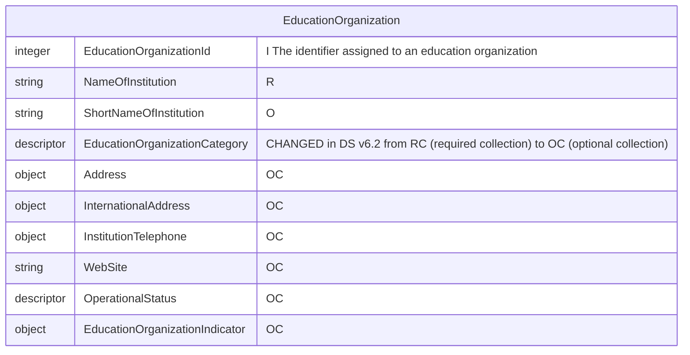
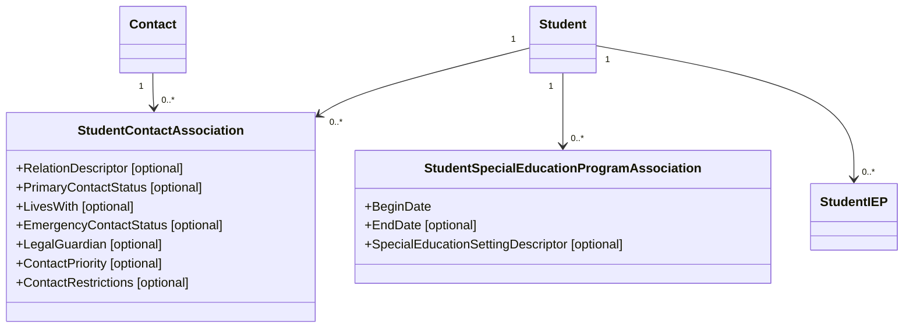
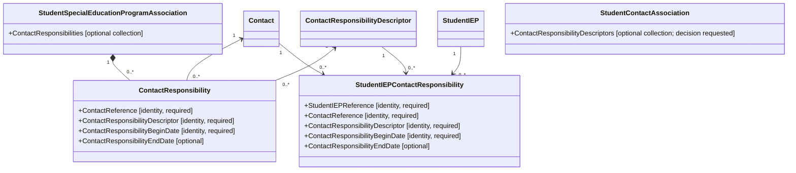
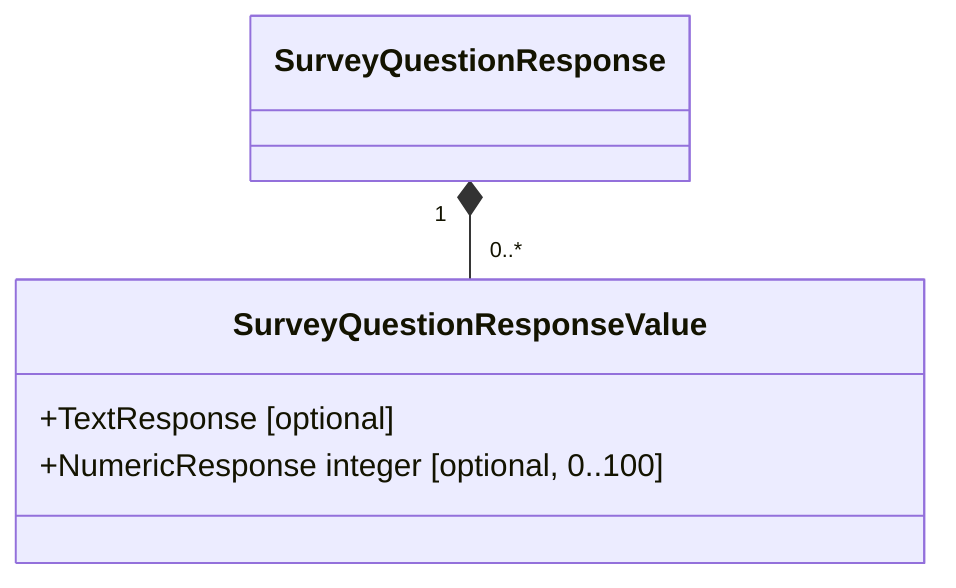
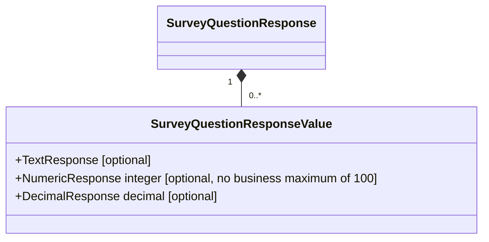

# Ed-Fi RFC 30b: Data Standard v6.2 — Education Organization Categories, Responsible Contact, and Survey Response Values

| Field | Value |
|---|---|
| RFC number | 30b |
| Product | Ed-Fi Data Standard |
| Target release | Data Standard v6.2 |
| Status | Draft for community review |
| Change type | Additive or constraint-relaxing; non-breaking |
| Related roadmap items | [#89: Make `educationOrganizationCategories` optional](https://github.com/Ed-Fi-Alliance-OSS/Ed-Fi-Technology-Roadmap/issues/89); [#151: Responsible Contact for Special Education](https://github.com/Ed-Fi-Alliance-OSS/Ed-Fi-Technology-Roadmap/issues/151); [#146: SurveyQuestionResponse NumericResponse](https://github.com/Ed-Fi-Alliance-OSS/Ed-Fi-Technology-Roadmap/issues/146); [#166: Data Standard v6.2](https://github.com/Ed-Fi-Alliance-OSS/Ed-Fi-Technology-Roadmap/issues/166) |

> [!NOTE]
> The Ed-Fi Alliance welcomes comments, questions, implementation examples, and concerns. Please identify the proposal number in each comment.
> **Notation:** `I` = identity / natural key · `R` = required · `O` = optional · `C` = array/collection · `object` = custom object ("common" in MetaEd). 

## 1. Synopsis

This RFC proposes three non-breaking changes for Data Standard v6.2:

1. Change the `educationOrganizationCategories` collection from required to optional on the EducationOrganization abstract entity.  Impact carried to subclass domain entities: `StateEducationAgency`, `LocalEducationAgency`, `School`, and `EducationServiceCenter`.
2. Add explicit, time-bound contact responsibility modeling for Special Education, including a `ContactResponsibility` optional collection object (common in MetaEd) on `StudentSpecialEducationProgramAssociation` ;  a corresponding `StudentIEPContactResponsibility` association for the Special Education Data Model (SEDM), and a non-dated responsibility descriptor collection on `StudentContactAssociation` for broader program uses.
3. Remove the business-rule maximum of 100 from `SurveyQuestionResponseValue.NumericResponse` and add an optional `DecimalResponse` for fractional values.

The changes preserve existing resources, identities, and payloads. Existing producers can continue sending Data Standard v6.1-shaped payloads; Data Standard v6.2 producers gain additional optional representations and one relaxed constraint.

## 2. Background

The Data Standard Work Group (DSWG), state agencies, vendors, and the Data Standard Architectural Review evaluated these needs from DSWG #17 onward.

- DSWG #17 identified that `StudentContactAssociation` cannot represent when a contact is legally responsible for a student's IEP, and that adding a begin date to the general association would mix a Special Education need into a general-purpose relationship.
- DSWG #19 supported a Special Education-specific, dated responsibility model and renamed generic begin/end dates to make their responsibility context explicit. The group supported both an optional common on `StudentSpecialEducationProgramAssociation` and an SEDM association linked to `StudentIEP`.
- The October architectural review approved the Data Standard v6.2 responsible-contact additions. It also confirmed the need for a separate Contact Responsibility descriptor so that a person's responsibility is not confused with an institution's or education organization's responsibility.
- DSWG #21 decided that `EducationOrganizationCategory` becomes optional in Data Standard v6.2 to avoid Validation API failures. Some concrete education organization resource remains identifiable even when the categories collection is absent.
- Community identified two related limitations in Survey responses: an unnecessary maximum of 100 on integer responses and no decimal response element.

These proposals are targeted to Data Standard v6.2 and can be delivered without making breaking changes changing existing natural keys or removing existing elements.

## 3. Problems

### 3.1 Proposal 1 — Required Education Organization categories block synchronization

Many implementations seed Education Organization records through SQL scripts. The `educationOrganizationCategories` collection is often omitted from those records. Because the collection is required in Data Standard v6.1, a later `PUT` through the API can fail when tools such as Ed-Fi Publisher synchronize the record.


### 3.2 Proposal 2 — Contact responsibility has no timeline or responsibility type

Special Education implementations must identify who is legally responsible for a student's IEP, such as an IDEA Parent or a court-appointed Surrogate Parent. That responsibility can change during the same school year and later return to a previous contact.

Data Standard v6.1 cannot represent that history adequately:

- `StudentContactAssociation.RelationDescriptor` describes a family or personal relationship, not the responsibility held by the contact.
- `LegalGuardian` is a Boolean and has no effective dates.
- `StudentContactAssociation` has no begin/end dates for a responsibility period.
- Replacing the current responsible contact overwrites history.
- Adding `BeginDate` to the identity of the general-purpose `StudentContactAssociation` was rejected because not every contact relationship is time-bound or Special Education-specific.

The DSWG also surfaced broader, non-Special Education examples such as Sun Bucks, transportation, and mailing responsibility. Community feedback was mixed on whether those broader cases should be included in Data Standard v6.2.

### 3.3 Proposal 3 — Survey numeric responses are artificially constrained and cannot store fractions

In Data Standard v6.1, `SurveyQuestionResponseValue.NumericResponse` is an integer limited to values from 0 through 100. The upper bound blocks valid integer responses such as counts, durations, salaries, and other quantities above 100.

The same response common has no decimal element. Real survey questions can request percentages, ratios, monetary values, average completion time, and other fractional values. Storing those answers as text reduces validation and analytic usability.

## 4. Proposal summary

| Proposal | Data Standard v6.1 | Data Standard v6.2 | Compatibility |
|---|---|---|---|
| 1. Education Organization categories | `educationOrganizationCategories` is a required collection on SEA, LEA, School, and ESC | Collection becomes optional | Constraint relaxation |
| 2. Responsible Contact | General contact relationship only; no responsibility timeline | New descriptor and dated object (common) for SSEPA; new SEDM association; optional broader descriptor use | Additive |
| 3. Survey response values | Integer `NumericResponse`, business maximum 100; no decimal element | Remove the 100 maximum; add optional `DecimalResponse` | Constraint relaxation plus additive field |

## 5. Model design: before Data Standard v6.1 and after Data Standard v6.2

### 5.1 Proposal 1 — Education Organization categories

#### Data Standard v6.2 

`educationOrganizationCategories` is required on each concrete Education Organization subtype.

Concepts:
`educationOrganizationCategories` Definition for the element is not changed. It is the classification of the education agency within the geographic boundaries of a state according to the level of administrative and operational control granted by the state. Is queryable. `educationOrganization`This entity represents any public or private institution, organization, or agency that provides instructional or support services to students or staff at any level.




**Behavioral guidance**

- Existing payloads containing the collection remain valid.
- A payload omitting the collection becomes valid.
- Consumers should use the concrete resource or resource link to identify whether an Education Organization is a School, LEA, SEA, or ESC.
- ODS/API documentation may explain the internal discriminator used to manage inheritance, but clients should not depend on direct SQL access or expect the discriminator as an API property.

We recommend sending the educationOrganizationCategories if available.
Illustrative fragment of a School payload in Data Standard v6.2 that sends the optional collection to classify the Education Organization as a School:

```json
{
  "schoolId": 255901044,
  "nameOfInstitution": "Example School",
  "shortNameOfInstitution": "Example",
  "educationOrganizationCategories": [
    {
      "educationOrganizationCategoryDescriptor": "uri://ed-fi.org/EducationOrganizationCategoryDescriptor#School"
    }
  ]
}
```

Illustrative fragment of the same School payload in Data Standard v6.2 that omits the optional collection:

```json
{
  "schoolId": 255901044,
  "nameOfInstitution": "Example School",
  "shortNameOfInstitution": "Example"
}
```

Both examples are fragments, not complete implementation-specific resources. `educationOrganizationCategories` is an array of objects, and each item carries one `educationOrganizationCategoryDescriptor` value. The descriptor namespace shown is the Ed-Fi default; implementations may use their own namespace.

### 5.2 Proposal 2 — Responsible Contact

#### Data Standard v6.1 — before



Data Standard v6.1 can indicate that a contact is a legal guardian or has a relationship such as parent or caretaker, but it cannot state the responsibility held by that contact over a defined period.

#### Data Standard v6.2 — after

The proposal adds one descriptor, one reusable common, and two Special Education placements of the concept.

**New descriptor**

`ContactResponsibility` defines the type of responsibility a contact has for a student. Candidate values include `IDEA Parent` and `Surrogate Parent`; the final seeded values require community confirmation.

**New reusable object (common)**
ResponsibleContact defines the contact and associated responsibility to the student effective on the begin date 

| Element | Type | Identity | Cardinality |
|---|---|---:|---:|
| `ContactReference` | Reference to `Contact` | Yes | Required |
| `ContactResponsibility` | Descriptor | Yes | Required |
| `ContactResponsibilityBeginDate` | Date | Yes | Required |
| `ContactResponsibilityEndDate` | Date | No | Optional |

**Placement 1 — core Special Education model**

Add `ContactResponsibility` as an optional collection on `StudentSpecialEducationProgramAssociation`.

**Placement 2 — SEDM**

Add `StudentIEPContactResponsibility`, associated to `StudentIEP`, with `Contact`, `ContactResponsibilityDescriptor`, and responsibility begin date in its identity and responsibility end date optional.

**Companion use outside Special Education**

The responsible-contact epic also considers adding an optional collection of `ContactResponsibilityDescriptor` values to `StudentContactAssociation`, without dates. This would support responsibilities such as mailing or program communication but would not preserve a responsibility timeline.



Illustrative SSEPA fragment:

```json
{
  "contactResponsibilities": [
    {
      "contactReference": {
        "contactUniqueId": "C1001"
      },
      "contactResponsibilityDescriptor": "uri://ed-fi.org/ContactResponsibilityDescriptor#IDEA Parent",
      "contactResponsibilityBeginDate": "2026-08-15",
      "contactResponsibilityEndDate": "2026-10-31"
    },
    {
      "contactReference": {
        "contactUniqueId": "C2002"
      },
      "contactResponsibilityDescriptor": "uri://ed-fi.org/ContactResponsibilityDescriptor#IDEA Parent",
      "contactResponsibilityBeginDate": "2026-11-01"
    }
  ]
}
```

The fragment demonstrates non-overwriting history. Exact generated JSON property names must be confirmed against the final MetaEd model.

### 5.3 Proposal 3 — Survey response values

#### Data Standard v6.1 — before



#### Data Standard v6.2 — after



**Proposed field behavior**

- `NumericResponse` remains an integer.
- The explicit maximum of 100 is removed. The representable range is still bounded by the generated physical data type.
- `DecimalResponse` is optional and additive.
- Based on community examples for percentages and monetary values, `decimal(10,3)` is the recommended working precision: up to seven digits to the left and three digits to the right of the decimal point.

Illustrative response fragments:

```json
{
  "numericResponse": 4250
}
```

```json
{
  "decimalResponse": 1250000.75
}
```

## 6. Processing and validation rules

### 6.1 Education Organization categories

1. The API must accept creation and update payloads that omit `educationOrganizationCategories`.
2. If the collection is present, each item must continue to contain a valid `EducationOrganizationCategoryDescriptor`.
3. No category values are deleted or deprecated by this proposal.
4. API and Best Practices documentation should not instruct clients to submit or query an internal ODS discriminator.

### 6.2 Responsible Contact

1. Each dated responsibility item must reference a Contact and contain a responsibility descriptor and begin date.
2. `ContactResponsibilityEndDate` is optional to allow an active responsibility period.
3. A change of responsible contact is represented by ending the prior period and adding a new item; it must not overwrite the prior item.
4. Multiple contacts may hold different responsibilities at the same time.
5. The model does not infer responsibility from `RelationDescriptor` or `LegalGuardian`.
6. Proposed rule for review: when both dates are present, the end date should not precede the begin date.
7. Proposed documentation convention: responsibility dates are inclusive unless an implementation publishes a different local rule.

### 6.3 Survey responses

1. `NumericResponse` continues to accept only whole numbers.
2. Values above 100 become valid when they are within the generated integer type's range.
3. `DecimalResponse` accepts fractional values within the approved precision and scale.
4. This RFC does not yet mandate mutual exclusivity among `TextResponse`, `NumericResponse`, and `DecimalResponse`; Question 10 asks whether model or API validation should enforce one response representation per value.

## 7. Backward compatibility and migration

### 7.1 Education Organization categories

No data migration is required. Existing payloads remain valid. Producers may stop sending the collection when it is unavailable or redundant. Consumers that currently use categories as their only type signal should update their logic to use the concrete resource context.

### 7.2 Responsible Contact

Existing `StudentContactAssociation`, SSEPA, and SEDM records remain valid. The new descriptor, common, and association are additive. Implementations with extensions should map historical records into the new structure only when they have reliable responsibility types and dates; the RFC does not require fabricated dates.

### 7.3 Survey responses

Existing values from 0 through 100 remain valid. No existing integer response is converted to decimal. Producers should use `NumericResponse` for whole numbers and `DecimalResponse` for fractional values after the latter is supported by the target API and storage implementation.

## 8. Alternatives considered

### 8.1 Education Organization categories

- **Keep the collection required.** Rejected because seeded records frequently omit it and later fail API synchronization.
- **Remove the collection.** Rejected because categories remain useful to implementations that populate them.
- **Expose the ODS discriminator through the API.** Not proposed. The discriminator is an internal inheritance mechanism in ODS/API implementations, not a portable Data Standard field.

### 8.2 Responsible Contact

- **Add begin date to the `StudentContactAssociation` identity.** Rejected by the community because the general relationship is not always time-bound and the proposal would be breaking.
- **Use only `RelationDescriptor` or `LegalGuardian`.** Rejected because these elements do not identify the responsibility or preserve its timeline.
- **Add only an undated Contact reference to SSEPA or StudentIEP.** Rejected because it does not prevent overwrite or represent transfer-and-revert history.
- **Create only a domain-agnostic, Education Organization-scoped association.** Not preferred because non-Special Education source systems may not carry a reliable begin date and because the strongest validated use case is Special Education.
- **Support only SSEPA or only SEDM.** Not preferred while both models are in use. Architectural review supported both during a possible longer-term transition, pending further migration research.

### 8.3 Survey responses

- **Raise the maximum but keep a new fixed business limit.** Possible, but no universal business maximum has been identified.
- **Store decimals as text.** Rejected because text weakens validation and analytics.
- **Change `NumericResponse` itself from integer to decimal.** Not proposed because an additive decimal field is clearer and less disruptive.

## 9. Implementation impact

The following artifacts should be updated for Data Standard v6.2:

- MetaEd model definitions and generated schemas.
- API metadata and OpenAPI output.
- Sample data:
  - Education Organization without categories.
  - IDEA Parent → Surrogate Parent → IDEA Parent history without overwrite.
  - Concurrent responsibility types or contacts.
  - Numeric survey values above 100.
  - Decimal survey values for a percentage and monetary amount.
- Automated validation and regression tests.
- Data Standard What's New documentation.
- Education Organization Best Practices.
- Responsible Contact Best Practices, including SSEPA versus SEDM guidance.
- Survey domain documentation.
- Certification and source-system mapping guidance where applicable.

## 10. Acceptance scenarios

| ID | Scenario | Expected result |
|---|---|---|
| EO-1 | Create or update a School without `educationOrganizationCategories` | Accepted |
| EO-2 | Create or update a School with one or more categories | Accepted |
| EO-3 | Synchronize a SQL-seeded Education Organization through Publisher when categories are absent | No failure caused solely by the absent collection |
| RC-1 | Biological parent is responsible, a surrogate takes over mid-year, and the biological parent later resumes responsibility | Three dated periods can be retained without overwrite |
| RC-2 | Two contacts hold different responsibilities concurrently | Both can be represented |
| RC-3 | SSEPA implementation does not use SEDM | Optional responsibility collection on SSEPA can represent the need |
| RC-4 | SEDM implementation ties responsibility to an IEP | `StudentIEPContactResponsibility` can represent the need |
| RC-5 | Existing implementation sends no responsibility data | Existing payload remains valid |
| SV-1 | Survey response contains integer `4250` | Accepted if within the generated integer range |
| SV-2 | Survey response contains decimal `87.375` | Accepted in `DecimalResponse` |
| SV-3 | Survey response contains monetary value `1250000.75` | Accepted if `decimal(10,3)` or a wider approved type is used |
| SV-4 | Existing response contains integer `100` | Remains valid |

## 11. Risks and considerations

- Supporting responsibility on both SSEPA and SEDM can create two representations of similar information. Best-practice guidance must identify that each representation is appropriate while the Early Access model or SSEPA are also supported.
- Required responsibility begin dates may not exist in all source systems. The dated model should remain optional at its parent location; implementations should not fabricate dates merely to populate it.
- Removing the 100 maximum broadens accepted data. Implementations may still apply survey-specific validation based on the question definition.

## 12. Questions for reviewers

Please respond by question number.

7. **Descriptor seed values:** Which values should be seeded? Are `IDEA Parent`, `Transportation`, `Mailing`,`Nurse-related`,`Texting`,`Attendance`, `Bus-route responsibilities`,`Other program-specific responsibilities`,sufficient for the initial release?
8. **Decimal precision:** Does `decimal(10,3)` meet community needs? 

## 13. References

- [RFC 29c format example](https://github.com/Ed-Fi-Alliance-OSS/Ed-Fi-Technology-Roadmap/discussions/160)
- [Data Standard v6.2 roadmap item #166](https://github.com/Ed-Fi-Alliance-OSS/Ed-Fi-Technology-Roadmap/issues/166)
- [Roadmap #89: Education Organization categories](https://github.com/Ed-Fi-Alliance-OSS/Ed-Fi-Technology-Roadmap/issues/89)
- [Roadmap #151: Responsible Contact for Special Education](https://github.com/Ed-Fi-Alliance-OSS/Ed-Fi-Technology-Roadmap/issues/151)
- [Roadmap #146: SurveyQuestionResponse NumericResponse](https://github.com/Ed-Fi-Alliance-OSS/Ed-Fi-Technology-Roadmap/issues/146)
- [2026-06-25 DSWG #17 notes](https://edfi.atlassian.net/wiki/spaces/GOV/pages/2558787588/2026-06-25+DSWG+17)
- [2026-09-03 DSWG #19 notes](https://edfi.atlassian.net/wiki/spaces/GOV/pages/2754838529/2026-09-03+DSWG+19)
- [2026-10-22 DSWG #21 notes](https://edfi.atlassian.net/wiki/spaces/GOV/pages/2937159681/2026-10-22+DSWG+21)
- [Architectural Review: Responsible Contact in SEDM and overlap with Special Education Association](https://edfi.atlassian.net/wiki/spaces/DATASTDDEV/pages/2875064332/Responsible+Contact+In+SEDM+and+overlap+with+Special+Education+Association+Performance+Evaluation+student+Transportation)
- [Ed-Fi RFC 25: Survey API](https://edfi.atlassian.net/wiki/spaces/rc/pages/25363230/ED-FI+RFC+25+-+SURVEY+API)
- Jira: `DATASTD-2612`, `DATASTD-2669`–`DATASTD-2677`, `DATASTD-2603`, `DATASTD-2705`, and `DATASTD-2706`
