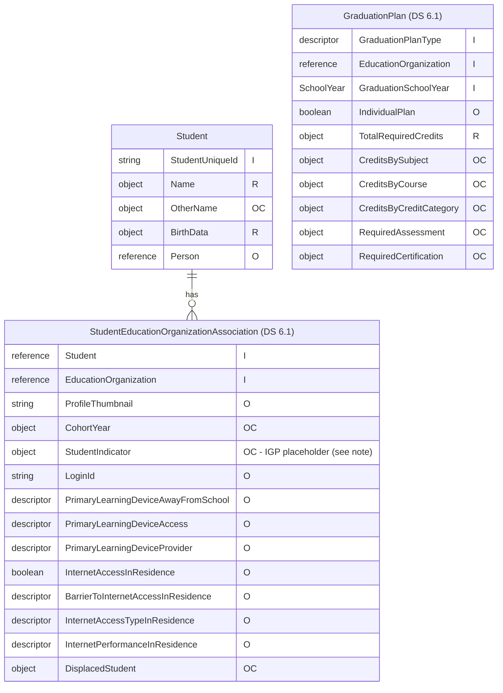
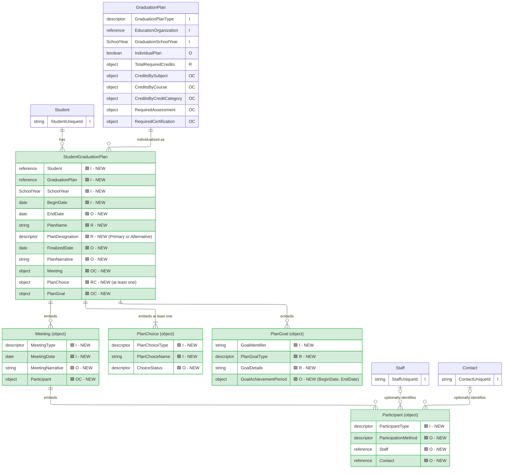

# Ed-Fi RFC 30c: Individual Graduation Plan (Graduation Domain)

> Product: Ed-Fi Data Standard \
> Affects: Ed-Fi Data Standard v6.2; Ed-Fi Resources API \
> Obsoletes: -- \
> Obsoleted By: -- \
> Status: Draft \
> Author: Sayee Srinivasan (Ed-Fi Alliance)
>
> November 18, 2026

## Synopsis

This Request for Comment (RFC) proposes a standard way to capture student-level Individual Graduation Plan (IGP) data in Ed-Fi.

The proposal **extends the existing Ed-Fi `GraduationPlan` instead of building a separate model**. It adds one new association entity, `StudentGraduationPlan`, which ties a `Student` to an existing `GraduationPlan` and carries the plan-level accountability data. Meeting, participant, plan-choice, and goal details are inline common collections on that one entity, not separate resources.

Two states drive this proposal:

- **South Carolina**, where IGP data can come from a Student Information System (SIS) or a College and Career Guidance System. South Carolina plans to start with data from the SIS, which writes to the Palmetto Collaborative; from there the data flows to the State Data System. The current mapping uses generic student indicators as a placeholder for IGP data, which gives the plan no structure of its own.
- **Indiana**, which already collects a state-level graduation plan record through an Ed-Fi extension whose shape closely matches this proposal.

This model is proposed for inclusion in **Ed-Fi Data Standard 6.2**. It is a **non-breaking** addition: it adds one new entity, `StudentGraduationPlan`, and new descriptors, and does not change any existing entity.

## Feedback

Please comment on this discussion. Comments from state education agencies (SEAs), local education agencies (LEAs), SIS vendors, and College and Career Guidance System vendors are all in scope.

## 1. Background and Problem Statement

### 1.1 South Carolina context

South Carolina's Palmetto Pathways initiative uses Individual Graduation Plans to help counselors plan each student's high school path from student interest and progress. The state needs student-specific IGP accountability data to reach the State Data System. That data is mostly metadata about the IGP: the student's selected major, career and technical education (CTE) cluster, postsecondary plan, and information about the meeting held with the student.

IGP data can come from two kinds of source systems: a Student Information System (SIS) or a College and Career Guidance System. South Carolina initially plans to receive the data from the SIS, which writes IGP data to the Palmetto Collaborative; from there it flows to the State Data System. **The model therefore gives every source system a clear, dedicated place to send the IGP, separate from the student demographic data these systems already send.**

### 1.2 Where the data lives today

The current South Carolina Department of Education (SCDE) mapping uses the `studentIndicators` collection of `StudentEducationOrganizationAssociation` as a potential placeholder for IGP data, with indicator names such as `IGP_Primary`, `IGP_Attendance`, `IGP_Participation`, `IGP_Cluster`, `IGP_Major`, and `IGP_Postsecondary_Plan`. The `studentIndicators` collection is on `StudentEducationOrganizationAssociation` in both Data Standard 5.x and 6.x. In 6.x, demographic data moved to a separate `StudentDemographic` entity, but the indicators did not move.

### 1.3 The problem

There are two problems with that location.

**No real structure for the plan.** Indicators can hold the values, but the IGP becomes a set of loosely related flags rather than a plan. There is no clean way to express that a meeting produced the plan, who attended, which choices belong to which plan, or which plan is primary.

**IGP data is placed in a large shared record.** `StudentEducationOrganizationAssociation` carries a wide range of other student data, far beyond IGP scope; in 5.x this includes demographics. Because Ed-Fi API writes replace the whole resource, including its collections, IGP data mapped there can only be updated by resending the entire record. It is also at risk if more than one system writes the same record, since each write can overwrite the other. The community identified this write-conflict risk.

### 1.4 Options evaluated

| Option | Approach | Concern raised |
| --- | --- | --- |
| A | GET the `StudentEducationOrganizationAssociation` record, stitch IGP indicators into `studentIndicators`, POST it back | Fragile: only safe if every process writing that record coordinates the same way; otherwise one write overwrites another |
| B | Write IGP data to the existing `/graduationPlan` resource | Most accountability data has no natural home there; extended properties would still be needed |
| C | Build a custom extension modeled for South Carolina's IGP | SCDE is committed to core endpoints; registering extensions across state ODS instances is a large lift |

This RFC combines the strengths of B and C. It builds on `GraduationPlan` (B) and adds a purpose-built structure (C), but as part of the core Data Standard (6.2), so that no state has to carry a private extension.

## 2. Legal and Policy Basis

### South Carolina

South Carolina's Education and Economic Development Act (EEDA), codified at S.C. Code Title 59, Chapter 59, requires the IGP:

| Section | What it covers | Model element |
| --- | --- | --- |
| § 59-59-140 | The IGP itself and its required contents | `StudentGraduationPlan` |
| § 59-59-110 | Declared area of academic focus (major) by end of grade 10 | `PlanChoice` (type = Major) |
| § 59-59-90 | Preferred cluster of study selected in grade 8 | `PlanChoice` (type = Career Cluster) |

Source: [South Carolina Education and Economic Development Act](https://www.scstatehouse.gov/code/t59c059.php). Implementing regulations (for example, R.43-234 and Diploma Pathways provisions) change more often than the statute and should be confirmed against current SCDE guidance.

### Indiana

Under IC 20-30-4-2, every Indiana student develops a graduation plan by the end of grade 8, with counselor and parent consultation. See [Section 10](#10-indiana-needs-policy-and-existing-extension).

## 3. Use Cases

| # | Use case |
| --- | --- |
| UC1 | **Record a student's graduation plan.** As an agency receiving IGP data from a source system (an SIS or a College and Career Guidance System), I need a structure that ties a student to the existing `GraduationPlan` and records plan-level facts (school year, active period, primary or alternative, finalized or not) without relying on student indicators. |
| UC2 | **Record IGP meetings.** I need to record the meeting(s) at which the plan was created, reviewed, amended, or finalized, so meeting context stays with the plan. A plan can have many meetings. |
| UC3 | **Record who participated.** I need to capture who took part in each meeting and how, optionally referencing the specific `Staff` member or `Contact`. |
| UC4 | **Record student goals.** As a counselor using an SIS or a College and Career Guidance System, I need to record goal statements (career, academic, postsecondary) as goals, not flatten them into a plan-level field. |
| UC5 | **Record structured plan choices.** I need to record selections such as career cluster, major, postsecondary plan, academy, CTE plan, seal, scholarship, or local opportunity, kept separate from goals. At least one choice is required. |
| UC6 | **Support a primary plan and alternatives.** I need to identify a student's primary plan and send alternatives, so students pursuing more than one diploma pathway are represented. |
| UC7 | **Meet a state's accountability collection.** As an SEA, I need the same structure to carry what I report at the state level (at minimum: student, school year, graduation plan, begin date, plan name, plan designation, and at least one plan choice). |
| UC8 | **Send IGP data separately from demographic data.** As a source system (an SIS or a College and Career Guidance System), I need to send IGP data to its own resource, separate from student demographic data, so IGP updates don't require resending a larger shared record and aren't at risk from other systems' writes. |

## 4. Design Approach

1. **Extend, don't duplicate.** Ed-Fi's `GraduationPlan` already models graduation requirements (credits by subject, course, and credit category, plus required assessments and certifications). It is identified by `EducationOrganization`, `GraduationPlanType`, and `GraduationSchoolYear` and works as a plan template. This RFC reuses it unchanged and individualizes it for a student.
2. **One new entity.** `StudentGraduationPlan` is the only new resource. That keeps the footprint small: one resource to send, query, and authorize.
3. **Inline collections, not new entities.** Meeting (with Participant), PlanChoice, and PlanGoal are common-type collections that serialize inside the `StudentGraduationPlan` resource, the same way `CohortYear` serializes inside `StudentEducationOrganizationAssociation`.
4. **The plan is the anchor.** Meetings, participants, choices, and goals all hang off the plan. The meeting is context for the plan, not its parent.
5. **A resource of its own.** Because IGP data has its own resource, whichever system produces the plan can write it without touching `StudentEducationOrganizationAssociation` (UC8).
6. **Borrows from the Special Education Data Model.** The structure borrows names and patterns from the Special Education Data Model (SEDM, Early Access in Data Standard 6.1): a student plan (`StudentIEP`), meetings about the plan (`IDEAEvent`), and goals that carry an identifier, details, a type, and an optional achievement period (`StudentIEPGoal`). Unlike the SEDM, where `IDEAEvent` and `StudentIEPGoal` are separate resources that reference the plan, meetings and goals here are embedded collections on `StudentGraduationPlan`, so the whole plan is sent in a single write. See §15 Q5.

## 5. Proposed Model

### 5.1 Diagrams

The following entity-relationship diagrams use GitHub-supported Mermaid syntax. New entities show all of their elements; in the proposed model, the reused `Student`, `Staff`, and `Contact` entities show only their keys.

#### Current Model Mapping

Today, IGP data has no entity of its own. The current mapping uses the student indicators on `StudentEducationOrganizationAssociation` as a potential placeholder for IGP data, and `GraduationPlan` holds only the plan's requirements.



> [!NOTE]
> Elements are taken from the Data Standard 6.1 XSD. In 5.x, `StudentEducationOrganizationAssociation` also carries demographic elements (for example, `Sex`, `Race`, `Address`, `Telephone`), and `StudentIndicator` is in the same place.
>
> **IGP placeholder:** The current SCDE mapping uses `StudentIndicator` entries as a potential placeholder for IGP data: `IGP_Primary`, `IGP_Attendance`, `IGP_Participation`, `IGP_Cluster`, `IGP_Major`, and `IGP_Postsecondary_Plan`. See §9.1.
>
> **Notation:** `I` = identity / natural key · `R` = required · `O` = optional · `OC` = optional collection · `RC` = required collection (at least one) · `object` = custom object ("common" in MetaEd; written `Object` in the data dictionary tables).

#### Proposed Model (DS 6.2)



> [!NOTE]
> `Student`, `GraduationPlan`, `Staff`, and `Contact` are existing entities and are not changed by this RFC. `Student`, `Staff`, and `Contact` show only their keys; `GraduationPlan` shows all of its Data Standard 6.1 elements. `StudentGraduationPlan` is the only new entity. `Meeting`, `Participant`, `PlanChoice`, and `PlanGoal` are objects ("common" in MetaEd) embedded in the `StudentGraduationPlan` resource, not separate resources. In the identity column of an object, `I` means the element that makes a row unique within its parent collection.
>
> **Notation:** `I` = identity / natural key · `R` = required · `O` = optional · `OC` = optional collection · `RC` = required collection (at least one) · `object` = custom object ("common" in MetaEd; written `Object` in the data dictionary tables) · 🟩 = new; new entities are also shaded green.

A student has **0..*** graduation plans. Each `StudentGraduationPlan` references one `GraduationPlan`, carries at least one `PlanChoice`, and may carry any number of meetings and goals.

### 5.2 StudentGraduationPlan (the one new entity)

The data dictionary uses the same notation as the diagrams: `I` = identity · `R` = required · `O` = optional · `OC` = optional collection · `RC` = required collection (at least one) · `Object` = custom object ("common" in MetaEd).

| Element | Type | Card. | Definition |
| --- | --- | --- | --- |
| Student | Reference | I | The student the plan is for. |
| GraduationPlan | Reference | I | The existing Ed-Fi `GraduationPlan` being individualized. Brings `EducationOrganization`, `GraduationPlanType` (the diploma pathway), and the plan's `GraduationSchoolYear`, which is why `StudentGraduationPlan` does not carry its own graduation school year. |
| SchoolYear | SchoolYear | I | The school year in which the plan is active. |
| BeginDate | Date | I | Date the plan becomes active or is identified. Distinguishes revisions within the same school year. When a plan is amended, the amended plan is a new record with a new `BeginDate`. |
| EndDate | Date | O | Last date on which the plan is active (inclusive). When a plan is amended, the prior record is ended by setting its `EndDate` to the day before the new record's `BeginDate`. |
| PlanName | String (120) | R | Human-readable name of the plan. |
| PlanDesignation | Descriptor | R | Whether this is the student's Primary or an Alternative plan. |
| FinalizedDate | Date | O | Date the plan was finalized. A plan without a `FinalizedDate` is not yet final. |
| PlanNarrative | String (2048) | O | Free-text narrative for the plan. |
| Meeting | Object | OC | Meetings about the plan. See 5.3. |
| PlanChoice | Object | RC | Structured selections in the plan; at least one is required. See 5.5. |
| PlanGoal | Object | OC | Student goal statements. See 5.6. |

**Identity:** `Student` + `GraduationPlan` + `SchoolYear` + `BeginDate`.

- `Student` and `GraduationPlan` are the two things the association links.
- `SchoolYear` scopes the plan to the year in which it is active, since a student's plan is reviewed and may change each year.
- `BeginDate` distinguishes an amended plan from the record it replaces within the same school year (§5.9 rule 4).
- No school is part of the identity. The only education organization on the record is the one that defines the `GraduationPlan`, which may be an SEA or LEA rather than the student's school. See §15 Q1 and Q2 on authorization and a possible `School` reference.

**Key size.** In a relational implementation, each embedded collection becomes a child table whose primary key includes the parent's key. Microsoft SQL Server limits a clustered index key to 900 bytes. Assuming references and descriptors are stored as integer surrogate keys and strings as `nvarchar` (2 bytes per character), the largest key in this model is on `PlanChoice`, at about 267 bytes, of which `PlanChoiceName` (120 characters) accounts for 240. `GoalIdentifier` (120 characters) puts `PlanGoal` at about 263 bytes. String elements that are part of an identity should stay at 120 characters or fewer so that keys remain well within the limit.

### 5.3 Meeting (object, OC)

| Element | Type | Card. | Definition |
| --- | --- | --- | --- |
| MeetingType | Descriptor | I | Type of meeting (initial planning, review, amendment, finalization). |
| MeetingDate | Date | I | Date the meeting occurred. |
| MeetingNarrative | String (2048) | O | Narrative notes about the meeting. |
| Participant | Object | OC | Who took part in the meeting. See 5.4. |

A plan can have many meetings. Each is unique within the plan by `MeetingType` + `MeetingDate`.

### 5.4 Participant (object on Meeting, OC)

| Element | Type | Card. | Definition |
| --- | --- | --- | --- |
| ParticipantType | Descriptor | I | Role of the participant (e.g., Parent/Step-Parent/Guardian, Other Representative, Counselor, Student). |
| ParticipationMethod | Descriptor | O | How the participant took part (e.g., In Person, Telephone, Online). |
| Staff | Reference | O | The specific Ed-Fi `Staff` member, when known (e.g., the counselor). |
| Contact | Reference | O | The specific Ed-Fi `Contact`, when known (e.g., the parent or guardian). |

Attendance can be reported **by role alone**, which is how IGP attendance is recorded today. The `Staff` and `Contact` references are optional and only used when an implementation wants to name the individual.

Participants are identified by `ParticipantType` alone. Two parents at one meeting are distinguished by type (for example, `Mother` and `Father`). Source systems are not asked to invent participant identifiers that they do not have.

### 5.5 PlanChoice (object, RC)

| Element | Type | Card. | Definition |
| --- | --- | --- | --- |
| PlanChoiceType | Descriptor | I | Kind of choice (Career Cluster, Major, Postsecondary Plan, Academy, …). |
| PlanChoiceName | String (120) | I | The selected or recommended value (e.g., Health Science, Sports Medicine, Four-Year College). |
| ChoiceStatus | Descriptor | O | Status of the choice (Selected, Recommended, …). |

Every plan carries at least one choice. Within a plan, each choice is unique by `PlanChoiceType` + `PlanChoiceName`. This allows more than one choice of the same type. In practice a student is expected to have only one choice per `PlanChoiceType`; the composite key future-proofs the model.

### 5.6 PlanGoal (object, OC)

The existing Data Standard 6.1 `Goal` entity and `GoalTypeDescriptor` were considered and not reused. Their definitions and data elements are oriented to educators rather than students, and `Goal` is identified by a person identifier, which is not a concept on the student side. The new object is therefore named `PlanGoal` (with `PlanGoalType`) to avoid a name collision. Generalizing the data model for both student and educator contexts, across `Goal`, `StudentIEPGoal`, and the IGP goal, should be examined for a future breaking release of the Data Standard.

`PlanGoal` borrows its shape from the Special Education Data Model's `StudentIEPGoal` (Early Access in Data Standard 6.1), which identifies a goal with `IEPGoalIdentifier` and describes it with `IEPGoalDetails`, `IEPGoalType`, and an optional `GoalAchievementPeriod`.

| Element | Type | Card. | Definition |
| --- | --- | --- | --- |
| GoalIdentifier | String (120) | I | Identifier for the goal within the plan. Allows more than one goal of the same type. |
| PlanGoalType | Descriptor | R | Career, academic, or postsecondary goal. |
| GoalDetails | String (2048) | R | The goal statement (e.g., "Veterinarian"). |
| GoalAchievementPeriod | Object | O | A `Period` object: the time period for which the goal is applicable or effective, with `BeginDate` (required) and `EndDate` (optional). Same structure as `StudentIEPGoal.GoalAchievementPeriod`. |

### 5.7 Reused: GraduationPlan (Ed-Fi core, unchanged)

`GraduationPlan` is reused as-is. No changes are proposed. Its Data Standard 6.1 elements are:

| Element | Type | Card. | Definition (from Ed-Fi Data Standard 6.1) |
| --- | --- | --- | --- |
| GraduationPlanType | Descriptor | I | The type of academic plan the student is following for graduation. |
| EducationOrganization | Reference | I | The education organization defining the plan. |
| GraduationSchoolYear | SchoolYear | I | The school year the student is expected to graduate. |
| IndividualPlan | Boolean | O | An indicator of whether the graduation plan is tailored for an individual. |
| TotalRequiredCredits | Object | R | A `Credits` object: the total number of credits required for graduation under this plan (`Credits`, plus optional `CreditType` and `CreditConversion`). |
| CreditsBySubject | Object | OC | The total credits required in a subject to graduate (`AcademicSubject`, `Credits`). |
| CreditsByCourse | Object | OC | The total credits required by taking a specific course, or one or more from a set of courses (`CourseSetName`, `Course` references, `Credits`, optional `WhenTakenGradeLevel`). |
| CreditsByCreditCategory | Object | OC | The total credits required based on the credit category (`CreditCategory`, `Credits`). |
| RequiredAssessment | Object | OC | The assessments and associated required score and performance level needed to satisfy graduation requirements. |
| RequiredCertification | Object | OC | The title or reference to the certification(s) required for graduation. |

### 5.8 Reused: Student, Staff, and Contact (Ed-Fi core, unchanged)

These entities are reused as-is; no changes are proposed. `StudentGraduationPlan` references `Student` (by `StudentUniqueId`), and `Participant` optionally references `Staff` (by `StaffUniqueId`) and `Contact` (by `ContactUniqueId`). See the Ed-Fi Data Standard 6.1 documentation for their full definitions.

### 5.9 Business rules

1. **One primary plan per student per school year.** At most one `StudentGraduationPlan` per `Student` + `SchoolYear` must have `PlanDesignation = Primary` on any given date. The composite key scopes plans by year but cannot enforce this rule by itself, so it is a documented validation rule, consistent with how Ed-Fi handles "primary" designations elsewhere.
2. **At least one PlanChoice** on every `StudentGraduationPlan`. South Carolina requires at least one plan choice, so the collection is required. Indiana does not currently collect plan choices; the purpose of an individualized graduation plan is to record one or more choices the student has selected, so Indiana will be guided to collect them.
3. **Finalized means `FinalizedDate` is present.** There is no separate status field.
4. **Amendments create a new record.** Source systems do not track a plan status that says whether a plan has been amended. When a plan is amended, the existing record is ended (`EndDate` set to the day before the new `BeginDate`) and a new record is created with a new `BeginDate`.

### 5.10 Relationship to the existing model

`StudentSchoolAssociation` already carries `graduationPlanReference` and an `alternativeGraduationPlans` collection. A question to the SIS Special Interest Group (SIG) found that many SIS vendors do not send this information to agencies. Whether those elements should be deprecated is an open question. Answering it requires focused meetings with SIS vendors and agencies, which this RFC treats as outside its scope. Deprecation would be a breaking change and cannot be part of Data Standard 6.2, so this RFC leaves the question unanswered for a future breaking release. See §15 Q4.

## 6. Descriptors

These are starter values. Each is a descriptor, so states govern and extend the lists without a model change. Values marked † were confirmed in Panorama's review (§11).

| Descriptor | Definition | Starter values |
| --- | --- | --- |
| PlanDesignation | Whether a student graduation plan is the student's primary plan or an alternative plan. | Primary · Alternative |
| MeetingType | The purpose of a meeting held about a student graduation plan. | Initial Planning Meeting† · Plan Review Meeting† · Plan Amendment Meeting† · Plan Finalization Meeting |
| ParticipantType | The role of a person who took part in a graduation plan meeting. | Parent/Step-Parent/Guardian† · Mother · Father · Other Representative† · Student · Counselor · Teacher · Administrator · Other |
| ParticipationMethod | How a participant took part in a graduation plan meeting. | In Person† · Telephone† · Email† · Online† · Video Conference† · Other† |
| PlanChoiceType | The kind of selection recorded in a graduation plan, such as a career cluster, major, or postsecondary plan. | Career Cluster† · Major† · Postsecondary Plan† · Academy† · CTE Plan · Seal · Scholarship · Local Opportunity |
| ChoiceStatus | The status of a plan choice, such as selected, recommended, or completed. | Selected · Recommended · Completed · Declined · Undecided |
| PlanGoalType | The category of a goal in a graduation plan. | Career Goal† · Academic Goal · Postsecondary Goal |

The SCDE mapping also uses **No Representative** as an attendance value. It is not included above; see §15 Q6.

Example `PlanChoiceName` values from the SCDE mapping: _Postsecondary Plan:_ Workforce/Apprenticeship, Military, Four-Year College, Two-Year College/Technical Training, Undecided. _Career Cluster:_ Health Science, Information Support and Services. _Major:_ Sports Medicine.

## 7. Goal vs. Plan Choice

| | PlanGoal | PlanChoice |
| --- | --- | --- |
| Represents | What the student is trying to accomplish | What the student selected in the plan |
| Example | "Become a veterinarian" | Health Science cluster · Sports Medicine major |
| Career goal | ✅ `PlanGoalType = Career Goal` | — |
| Career cluster | — | ✅ `PlanChoiceType = Career Cluster` |
| Major | — | ✅ `PlanChoiceType = Major` |
| Postsecondary plan | When phrased as an aspiration | When it is the selected option |

Career goals are often selected from a curated list based on the Standard Occupational Classification (SOC) system. They map to `PlanGoal` because they describe an aspiration, not a pathway selection.

## 8. Alternatives Considered

Section 1.4 covers keeping IGP data in student indicators (Option A), using `GraduationPlan` alone (Option B), and a custom state extension (Option C). Two other alternatives were also considered:

| Alternative | Why not |
| --- | --- |
| Ed-Fi `Path` / `StudentPath` | Built for formal pathways with phases and milestones. The current need is to record selections, so Path would over-model it. A future version could add an optional Path link from a choice. |
| Four or five standalone entities (earlier working draft: `IGPEvent`, `StudentIGP`, `StudentIGPGoal`, `StudentIGPPlanChoice`) | More resources to send, authorize, and govern. The same data fits as inline collections on one entity. |

## 9. Source Mappings

### 9.1 SCDE student indicators (`StudentEducationOrganizationAssociation`) → model

| Current indicator | New location |
| --- | --- |
| `IGP_Primary` | `StudentGraduationPlan.PlanDesignation` (Primary) |
| `IGP_Attendance` | `Meeting.Participant.ParticipantType` |
| `IGP_Participation` | `Meeting.Participant.ParticipationMethod` |
| `IGP_Cluster` | `PlanChoice` (type = Career Cluster) |
| `IGP_Major` | `PlanChoice` (type = Major) |
| `IGP_Postsecondary_Plan` | `PlanChoice` (type = Postsecondary Plan) |

### 9.2 IGP data elements → model

This table shows where each piece of IGP data a source system sends lands in the model.

| IGP data element | Example | Model element |
| --- | --- | --- |
| School year of the plan | 2028–2029 | `StudentGraduationPlan.SchoolYear` |
| Plan name | (plan title) | `StudentGraduationPlan.PlanName` |
| Primary plan flag | Yes | `StudentGraduationPlan.PlanDesignation` = Primary |
| Plan completed / finalized | | `FinalizedDate` populated |
| Plan in progress | | Record sent, no `FinalizedDate` |
| Plan not started | | No record sent |
| Career goal | Veterinarian | `PlanGoal` (type = Career Goal), `GoalDetails` |
| Career cluster | Health Science | `PlanChoice` (type = Career Cluster) |
| Major | Sports Medicine | `PlanChoice` (type = Major) |
| Postsecondary plan | Four-Year College | `PlanChoice` (type = Postsecondary Plan) |
| Academy | (academy name) | `PlanChoice` (type = Academy) |
| Meeting type and date | Initial planning meeting | `Meeting` |
| Attendee role | Parent/step-parent/guardian | `Meeting.Participant.ParticipantType` |
| Participation method | Video conference | `Meeting.Participant.ParticipationMethod` |

### 9.3 Indiana `StudentSchoolGraduationPlans` → model

| Indiana element | Model element |
| --- | --- |
| `StudentUniqueId` | `StudentGraduationPlan.Student` |
| `SchoolId` | No direct equivalent. The `GraduationPlan` reference carries the education organization that defines the plan. |
| `GraduationPlanReference` (EducationOrganizationId, GraduationPlanTypeDescriptor, GraduationSchoolYear) | `StudentGraduationPlan.GraduationPlan` |
| `BeginDate` | `StudentGraduationPlan.BeginDate` |
| `EndDate` | `StudentGraduationPlan.EndDate` |
| `alternativeGraduationPlans[].GraduationPlanReference` | A second `StudentGraduationPlan` with `PlanDesignation = Alternative` |
| _(not collected)_ | `StudentGraduationPlan.SchoolYear`. Can be derived from `BeginDate`; otherwise Indiana to supply. |
| _(implied by structure)_ | `StudentGraduationPlan.PlanDesignation`. The top-level plan is `Primary`; each entry in `alternativeGraduationPlans` is `Alternative`. |
| _(not collected)_ | `StudentGraduationPlan.PlanName`. Indiana to supply. |
| _(not collected)_ | `StudentGraduationPlan.PlanChoice`. Indiana will be guided to collect plan choices (see §5.9 rule 2). |

**One structural difference.** Indiana carries the primary plan and its alternatives on one record (`alternativeGraduationPlans` is a collection on it). This model uses one record per plan and marks each Primary or Alternative. The information is the same, but the shape differs, and an Indiana mapping would split one record into two.

## 10. Indiana: Needs, Policy, and Existing Extension

**Policy.** Under IC 20-30-4-2, every Indiana student develops a graduation plan by the end of grade 8. Completing it in grade 7 is optional and counts for accountability. The plan is developed with a school counselor and parent consultation, becomes part of the student's permanent record, and is accessible to parents under FERPA.

**What stays local and what is reported.** The full plan (courses, seals, goals, career and school choices) is collected and kept locally. Only a lightweight Grad Plan indicator goes to the state Data Exchange. It records that an official plan exists, is reported in grade 8 or 9 (no later than the end of grade 9), and allows up to two plans: a primary and one alternative.

**Indiana already collects this through an Ed-Fi extension.** The state record is reported through the `StudentSchoolGraduationPlans` resource. It associates a student and school to a `GraduationPlan` with begin and end dates and carries an `alternativeGraduationPlans` collection. The plan type is the `GraduationPlanTypeDescriptor`, carrying Indiana's diploma pathways:

- Indiana Diploma
- Indiana Diploma with Enrollment Honors / Enrollment Honors Plus
- Indiana Diploma with Enlistment Honors / Enlistment Honors Plus
- Indiana Diploma with Employment Honors / Employment Honors Plus
- Alternate Diploma

This is, in substance, the student-to-`GraduationPlan` association this RFC proposes, already running in production. Indiana's state indicator maps to the plan-level fields of `StudentGraduationPlan` (§9.3). Indiana's locally retained plan maps to the inline collections.

**Coverage of the Indiana local template.** Most of the content on Indiana's graduation plan template maps to this model or to other Ed-Fi domains: diploma requirements to `GraduationPlan`; seals and school/program choices to `PlanChoice`; career interests to `PlanGoal`; assessment scores to the Assessment domain; earned credits and grades to the Student Academic Record domain. Two items have no home in this model: the per-year planned course schedule, and formal parent approval with a date.

Policy source: [Indiana Department of Education (IDOE) — How to Report Student Grad Plan](https://idoe.atlassian.net/wiki/spaces/IKHTV/pages/1604091905/How+to+Report+Student+Grad+Plan)

## 11. Panorama Model Review

Panorama reviewed the proposed model and provided the feedback below. The review was based on an earlier working draft (the multi-entity `IGPEvent` / `StudentIGP` model), so several items are already met by the current design.

| Recommendation | Disposition | Notes |
| --- | --- | --- |
| Event should be a child of Plan, with many events per plan | **Already met** | `Meeting` is a 0..* collection on `StudentGraduationPlan`. |
| Add `SchoolYear` to the plan's identity | **Adopted** | Plans are scoped by the year they are active, which is stable. `GraduationSchoolYear` is not carried on `StudentGraduationPlan`; it comes from the referenced `GraduationPlan`, where it is part of the key. |
| Add a plan name | **Adopted** | `PlanName` (required), as proposed by Panorama. |
| Keep free text out of the Choice identity | **Not adopted** | `PlanChoiceName` is part of the key with `PlanChoiceType`, so that more than one choice of the same type can be recorded. |
| Primary indicator should be required | **Adopted, as a descriptor** | `PlanDesignation` (Primary / Alternative) is required. It replaces a boolean so alternatives can be sent. |
| Record attendance by role, not by person | **Compatible** | `ParticipantType` alone is enough; no participant identifier is added. `Staff` / `Contact` references are optional and need not be sent. |
| Add "Descriptor" suffix to every controlled-vocabulary field | **Not adopted in the model** | Ed-Fi MetaEd adds the "Descriptor" suffix when it generates technical artifacts, so the API properties still end in `…Descriptor`, as Panorama expects. |
| Remove the Goal identifier; identify PlanGoal by type | **Not adopted** | `GoalIdentifier` allows more than one goal of the same type, and matches the Special Education Data Model's `IEPGoalIdentifier`. A source system that sends one goal per type still fits. |
| PlanGoal and Choice reference the meeting where they were set | **Not adopted** | South Carolina's requirements tie meetings to the plan as a whole, not to individual goals or choices. Meetings are recorded once on the plan (`Meeting`). |
| `EventReason` as a descriptor | **Not adopted** | Meeting reason was removed. `MeetingType` and `MeetingNarrative` cover the need. |
| `PlanStatus` / `ProgressStatus` descriptors | **Not adopted** | Status is expressed by `FinalizedDate` and `PlanDesignation`. See the mapping in §9.2. |
| `GoalAchievementPeriod` | **Adopted, following the Special Education Data Model** | Added as an optional `Period` (`BeginDate`, `EndDate`), the same structure as `StudentIEPGoal.GoalAchievementPeriod`. This settles the type question Panorama raised. |

## 12. Implementation Guidance

- **Source.** A source system, either an SIS or a College and Career Guidance System, writes `StudentGraduationPlan`. South Carolina initially plans to receive the data from the SIS, which writes to the Palmetto Collaborative; from there the data flows to the State Data System. `StudentEducationOrganizationAssociation` keeps carrying its other student data.
- **Authorization.** Not yet decided. See §15 Q1 and Q2.
- **Status mapping.** Send nothing for "not started" plans. Send a record without `FinalizedDate` for plans in progress. Populate `FinalizedDate` when the plan is final.
- **Updates.** Because collections are embedded, the source system sends the complete plan (all meetings, participants, choices, and goals) on each write.
- **Descriptor governance.** Seed the starter values in §6. States add values through descriptor governance, not schema changes.

## 13. API Specification

This RFC introduces one new REST API resource and seven new descriptor resources under the `ed-fi` namespace, following standard Ed-Fi API conventions. Each resource supports `GET`, `POST`, `PUT`, and `DELETE` operations. Meetings, participants, plan choices, and plan goals are embedded collections on `StudentGraduationPlan`, not separate resources.

| Resource | Route |
| --- | --- |
| StudentGraduationPlan | `/ed-fi/studentGraduationPlans` |
| PlanDesignationDescriptor | `/ed-fi/planDesignationDescriptors` |
| MeetingTypeDescriptor | `/ed-fi/meetingTypeDescriptors` |
| ParticipantTypeDescriptor | `/ed-fi/participantTypeDescriptors` |
| ParticipationMethodDescriptor | `/ed-fi/participationMethodDescriptors` |
| PlanChoiceTypeDescriptor | `/ed-fi/planChoiceTypeDescriptors` |
| ChoiceStatusDescriptor | `/ed-fi/choiceStatusDescriptors` |
| PlanGoalTypeDescriptor | `/ed-fi/planGoalTypeDescriptors` |

The full OpenAPI specification will be published with Ed-Fi Data Standard 6.2.

### 13.1 Example

An illustrative `StudentGraduationPlan` request body. Property names follow Ed-Fi API naming conventions; the final names are generated from the MetaEd model and may differ slightly.

```json
{
  "studentReference": {
    "studentUniqueId": "604822"
  },
  "graduationPlanReference": {
    "educationOrganizationId": 255901,
    "graduationPlanTypeDescriptor": "uri://ed-fi.org/GraduationPlanTypeDescriptor#Standard",
    "graduationSchoolYear": 2029
  },
  "schoolYearTypeReference": {
    "schoolYear": 2027
  },
  "beginDate": "2026-09-15",
  "planName": "Health Science Pathway",
  "planDesignationDescriptor": "uri://ed-fi.org/PlanDesignationDescriptor#Primary",
  "finalizedDate": "2026-10-02",
  "planNarrative": "Student plans to pursue a career in sports medicine.",
  "meetings": [
    {
      "meetingTypeDescriptor": "uri://ed-fi.org/MeetingTypeDescriptor#Initial Planning Meeting",
      "meetingDate": "2026-09-15",
      "meetingNarrative": "Reviewed career interest inventory results.",
      "participants": [
        {
          "participantTypeDescriptor": "uri://ed-fi.org/ParticipantTypeDescriptor#Student",
          "participationMethodDescriptor": "uri://ed-fi.org/ParticipationMethodDescriptor#In Person"
        },
        {
          "participantTypeDescriptor": "uri://ed-fi.org/ParticipantTypeDescriptor#Counselor",
          "participationMethodDescriptor": "uri://ed-fi.org/ParticipationMethodDescriptor#In Person",
          "staffReference": {
            "staffUniqueId": "207219"
          }
        },
        {
          "participantTypeDescriptor": "uri://ed-fi.org/ParticipantTypeDescriptor#Parent/Step-Parent/Guardian",
          "participationMethodDescriptor": "uri://ed-fi.org/ParticipationMethodDescriptor#Telephone"
        }
      ]
    }
  ],
  "planChoices": [
    {
      "planChoiceTypeDescriptor": "uri://ed-fi.org/PlanChoiceTypeDescriptor#Career Cluster",
      "planChoiceName": "Health Science",
      "choiceStatusDescriptor": "uri://ed-fi.org/ChoiceStatusDescriptor#Selected"
    },
    {
      "planChoiceTypeDescriptor": "uri://ed-fi.org/PlanChoiceTypeDescriptor#Major",
      "planChoiceName": "Sports Medicine",
      "choiceStatusDescriptor": "uri://ed-fi.org/ChoiceStatusDescriptor#Selected"
    },
    {
      "planChoiceTypeDescriptor": "uri://ed-fi.org/PlanChoiceTypeDescriptor#Postsecondary Plan",
      "planChoiceName": "Four-Year College",
      "choiceStatusDescriptor": "uri://ed-fi.org/ChoiceStatusDescriptor#Selected"
    }
  ],
  "planGoals": [
    {
      "goalIdentifier": "1",
      "planGoalTypeDescriptor": "uri://ed-fi.org/PlanGoalTypeDescriptor#Career Goal",
      "goalDetails": "Athletic trainer",
      "goalAchievementPeriod": {
        "beginDate": "2026-09-15"
      }
    }
  ]
}
```

## 14. Timeline

- **Target release:** Ed-Fi Data Standard 6.2.
- **Comments requested by:** December 15, 2026.

## 15. Questions for the Community

Please reference the question number (for example, "RFC 30c Q2") when responding.

1. **Q1. Authorization.** The `GraduationPlan` reference carries `EducationOrganization` as a required identity element. Can authorization for `StudentGraduationPlan` be handled through that education organization? The concern is that the education organization defining the plan is often the SEA or LEA, while the system writing the record is usually a school's or district's SIS. Under relationship-based authorization, a caller whose claims are for a school or LEA may not be authorized for a record whose only education organization is the SEA above it. How authorization would resolve needs confirmation from the Ed-Fi ODS/API and Data Management Service teams. (§5.2, §12)
2. **Q2. School reference.** Should `StudentGraduationPlan` carry a `School` reference? Indiana's extension includes `SchoolId` in its key. A school would give authorization a direct path to the writing organization. It could be part of the identity, as in Indiana, or a required non-identity element. In the identity, a student who changes schools mid-year would need a new record for the new school. (§5.2, §9.3)
3. **Q3. `EndDate` is inclusive.** This RFC defines `EndDate` as the last date on which the plan is active, consistent with Ed-Fi's recommendation for inclusive dates. An amended plan's prior record therefore ends the day before the new record's `BeginDate`. Do source systems record end dates this way, or as the date the replacement plan starts? (§5.2, §5.9)
4. **Q4. `StudentSchoolAssociation` graduation plan elements.** `StudentSchoolAssociation` already carries `graduationPlanReference` and `alternativeGraduationPlans`. Does your organization send or use these elements today? This RFC does not change them, but the answers will inform whether a future breaking release should deprecate them. (§5.10)
5. **Q5. Embedded collections or separate resources.** Meetings, participants, plan choices, and plan goals are embedded collections on `StudentGraduationPlan`, so a source system sends the complete plan on every write. The Special Education Data Model instead makes meetings (`IDEAEvent`) and goals (`StudentIEPGoal`) separate resources that reference the plan. Should this model go further toward the SEDM, with meetings and goals as separate resources? Separate resources allow a meeting or goal to be added or changed without resending the whole plan, and would allow other systems (such as a College and Career Guidance System) to write meetings or goals independently, at the cost of more resources and references to manage. (§4, §5.3, §5.6, §12)
6. **Q6. Recording "No Representative".** The SCDE mapping uses **No Representative** to record that no parent or representative attended a meeting. That is the absence of a participant rather than a type of participant, so this RFC does not include it as a `ParticipantType` value. Without it, a meeting with no `Parent/Step-Parent/Guardian`, `Mother`, `Father`, or `Other Representative` participant would imply that no representative attended, but that cannot be told apart from a meeting where attendance was not recorded. Do states need to distinguish these cases? If so, should "No Representative" be a `ParticipantType` value, or should the meeting carry a separate indicator? (§5.4, §6)

## References

### Source documents

- SCDE — _Individual Graduation Plan (IGP) Data Passback in South Carolina_ (overview of the write-conflict challenge and options A–C)
- Panorama — _IGP Ed-Fi Extension — Model Assessment Notes_ (v2.0, July 6, 2026) and _IGP Ed-Fi Extension Review Matrix_
- IDOE — `StudentSchoolGraduationPlans` data collection example (Indiana state reporting specification)
- [Learn More Indiana — Graduation Plan template (New Diploma)](https://learnmoreindiana.org/wp-content/uploads/2026/04/26-Graduation-Plan_New-Diploma.pdf)

### Standards, statutes, and policy

- [S.C. Code Title 59, Chapter 59 (EEDA): _South Carolina Education and Economic Development Act_](https://www.scstatehouse.gov/code/t59c059.php)
- [Indiana Code IC 20-30-4-2; IDOE: _How to Report Student Grad Plan_](https://idoe.atlassian.net/wiki/spaces/IKHTV/pages/1604091905/How+to+Report+Student+Grad+Plan)
- [Ed-Fi Data Standard: Graduation Domain](https://docs.ed-fi.org/reference/data-exchange/data-standard/model-reference/graduation-domain/)
- [Ed-Fi Data Standard v6.1.0 source (Ed-Fi-Core.xsd: `GraduationPlan`, `StudentEducationOrganizationAssociation`, `StudentIEP`, `StudentIEPGoal`, `IDEAEvent`)](https://github.com/Ed-Fi-Alliance-OSS/Ed-Fi-Data-Standard/tree/v6.1.0)
